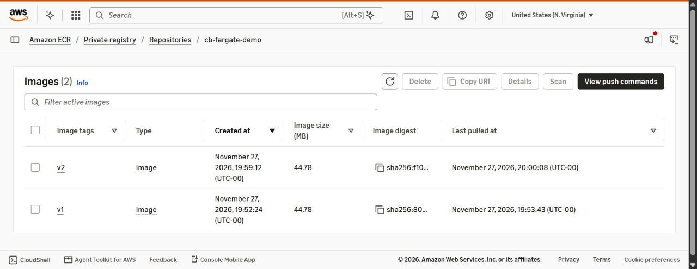
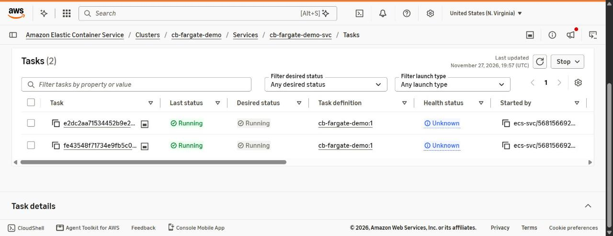
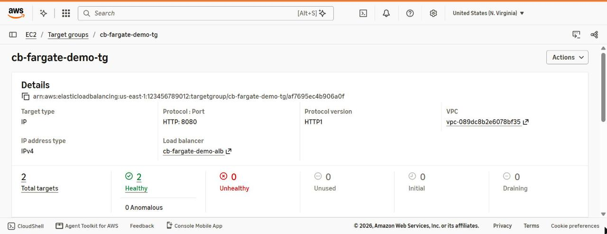
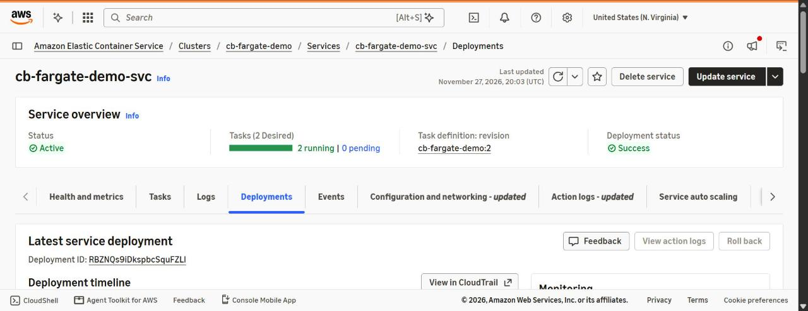
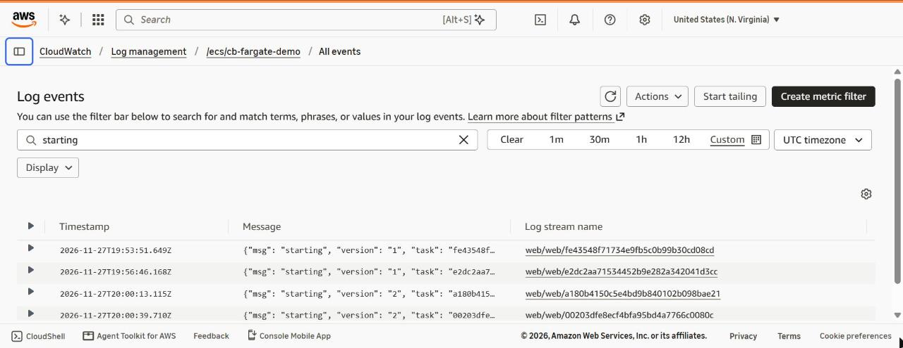

# Deploy a Containerized Web App on AWS with ECR, ECS Fargate and an Application Load Balancer (Step by Step)


Containers solve the "works on my machine" problem, but you still need somewhere to run them. **Amazon ECS on AWS Fargate** runs containers without any servers to patch or scale: you describe the container, and AWS finds the capacity.

In this post I'm taking a small web app from source code to a production-style deployment: the image goes into **Amazon ECR**, runs as **two Fargate tasks** behind an **Application Load Balancer**, and then gets updated to version 2 with a **rolling deployment**. I measured that rollout from the outside, and not a single request failed.

## What I'm building

```
Browser / curl
     │  HTTP :80
     ▼
Application Load Balancer  ── health checks /health
     │  only the ALB can reach port 8080
     ▼
ECS Service (Fargate, ARM64)
 ├── Task 1  ── container "web" :8080
 └── Task 2  ── container "web" :8080
     │
     ├──▶ image pulled from Amazon ECR
     └──▶ logs to CloudWatch Logs
```

**Prerequisites:** an AWS account, the AWS CLI v2 configured, and Docker. I'm using the **default VPC** in `us-east-1` to keep the networking simple.

```bash
export REGION=us-east-1
export NAME=cb-fargate-demo
export ACCOUNT_ID=$(aws sts get-caller-identity --query Account --output text)
export REPO_URI=$ACCOUNT_ID.dkr.ecr.$REGION.amazonaws.com/$NAME
```

## Step 1: The app and its Dockerfile

The app is a tiny Python web server with no dependencies. It has three routes: `/` (an HTML page), `/health` (for the load balancer) and `/api/info`, which returns the app version and **which task served the request**. That last one makes load balancing visible later. The task ID comes from the ECS task metadata endpoint that Fargate injects into every container.

```python
def task_id():
    """Short ECS task ID from the task metadata endpoint (falls back to 'local')."""
    uri = os.environ.get("ECS_CONTAINER_METADATA_URI_V4")
    if not uri:
        return "local"
    with urllib.request.urlopen(f"{uri}/task", timeout=1) as r:
        return json.load(r)["TaskARN"].split("/")[-1][:8]
```

The rest of `app.py` is about 50 lines of standard-library `http.server` code. The Dockerfile:

```dockerfile
# Pulled from Amazon ECR Public to avoid Docker Hub rate limits
FROM public.ecr.aws/docker/library/python:3.12-slim

ARG APP_VERSION=1
ENV APP_VERSION=${APP_VERSION} PYTHONUNBUFFERED=1

WORKDIR /app
COPY app.py .

# Run as a non-root user
RUN useradd --create-home appuser
USER appuser

EXPOSE 8080
HEALTHCHECK --interval=30s --timeout=3s CMD python -c "import urllib.request; urllib.request.urlopen('http://localhost:8080/health')"
CMD ["python", "app.py"]
```

Two small habits worth copying: pulling the base image from **ECR Public** (no Docker Hub rate limits in CI), and running as a **non-root user**.

## Step 2: Push the image to Amazon ECR

```bash
aws ecr create-repository --repository-name $NAME \
  --image-scanning-configuration scanOnPush=true

aws ecr get-login-password --region $REGION | \
  docker login --username AWS --password-stdin $REPO_URI

docker build --platform linux/arm64 --build-arg APP_VERSION=1 -t $REPO_URI:v1 .
docker push $REPO_URI:v1
```

I'm building for **ARM64** because Fargate on Graviton costs about 20% less than x86 for the same vCPU and memory.

> 💡 **No Docker on your machine?** I didn't have it on the laptop I used for this, so I let **AWS CodeBuild** do the build. I zipped the source, uploaded it to S3, and an ARM CodeBuild project ran the same `docker build` and `docker push` in about **22 seconds** per image. The `buildspec.yml` is just three commands:
>
> ```yaml
> version: 0.2
> phases:
>   pre_build:
>     commands:
>       - aws ecr get-login-password --region $AWS_DEFAULT_REGION | docker login --username AWS --password-stdin $REPO_URI
>   build:
>     commands:
>       - docker build --build-arg APP_VERSION=$APP_VERSION -t $REPO_URI:v$APP_VERSION .
>   post_build:
>     commands:
>       - docker push $REPO_URI:v$APP_VERSION
> ```
>
> The project needs `privilegedMode: true` to run Docker, and an IAM role that can push to this one repository.



## Step 3: Security groups

Two security groups make a small but important security boundary:

- the **ALB** accepts HTTP from the internet;
- the **tasks** accept port 8080 **only from the ALB's security group**, so nobody can bypass the load balancer.

```bash
VPC_ID=$(aws ec2 describe-vpcs --filters Name=is-default,Values=true --query "Vpcs[0].VpcId" --output text)
SUBNETS=$(aws ec2 describe-subnets --filters Name=vpc-id,Values=$VPC_ID Name=default-for-az,Values=true \
  --query "Subnets[0:2].SubnetId" --output text | tr '\t' ',')

ALB_SG=$(aws ec2 create-security-group --group-name $NAME-alb-sg \
  --description "ALB: HTTP from anywhere" --vpc-id $VPC_ID --query GroupId --output text)
aws ec2 authorize-security-group-ingress --group-id $ALB_SG --protocol tcp --port 80 --cidr 0.0.0.0/0

TASK_SG=$(aws ec2 create-security-group --group-name $NAME-task-sg \
  --description "Tasks: 8080 from the ALB only" --vpc-id $VPC_ID --query GroupId --output text)
aws ec2 authorize-security-group-ingress --group-id $TASK_SG --protocol tcp --port 8080 --source-group $ALB_SG
```

## Step 4: The Application Load Balancer

Fargate tasks get their own network interface (the `awsvpc` network mode), so the target group uses **`--target-type ip`**, not `instance`.

```bash
ALB_ARN=$(aws elbv2 create-load-balancer --name $NAME-alb --type application --scheme internet-facing \
  --subnets ${SUBNETS//,/ } --security-groups $ALB_SG \
  --query "LoadBalancers[0].LoadBalancerArn" --output text)

TG_ARN=$(aws elbv2 create-target-group --name $NAME-tg --protocol HTTP --port 8080 \
  --vpc-id $VPC_ID --target-type ip \
  --health-check-path /health --health-check-interval-seconds 10 --healthy-threshold-count 2 \
  --query "TargetGroups[0].TargetGroupArn" --output text)

# Faster rollouts: stop sending traffic to old tasks after 10s instead of the default 300s
aws elbv2 modify-target-group-attributes --target-group-arn $TG_ARN \
  --attributes Key=deregistration_delay.timeout_seconds,Value=10

aws elbv2 create-listener --load-balancer-arn $ALB_ARN --protocol HTTP --port 80 \
  --default-actions Type=forward,TargetGroupArn=$TG_ARN
```

The **deregistration delay** is the one setting I always change for demos and small apps. With the default 300 seconds, every deployment waits five minutes for old connections to drain.

## Step 5: Cluster, execution role and task definition

The **task execution role** lets ECS pull the image from ECR and write logs to CloudWatch on your behalf. Your app code doesn't use it; that's what a separate *task role* is for, and this app doesn't need one.

```bash
aws ecs create-cluster --cluster-name $NAME

aws iam create-role --role-name $NAME-exec-role --assume-role-policy-document '{
  "Version": "2012-10-17",
  "Statement": [{"Effect": "Allow", "Principal": {"Service": "ecs-tasks.amazonaws.com"}, "Action": "sts:AssumeRole"}]}'
aws iam attach-role-policy --role-name $NAME-exec-role \
  --policy-arn arn:aws:iam::aws:policy/service-role/AmazonECSTaskExecutionRolePolicy

aws logs create-log-group --log-group-name /ecs/$NAME
aws logs put-retention-policy --log-group-name /ecs/$NAME --retention-in-days 7
```

The task definition is the "recipe" for a task: image, CPU, memory, ports and logging. **0.25 vCPU and 512 MB** is the smallest Fargate size and plenty for this app.

```json
{
  "family": "cb-fargate-demo",
  "requiresCompatibilities": ["FARGATE"],
  "networkMode": "awsvpc",
  "cpu": "256",
  "memory": "512",
  "runtimePlatform": {"cpuArchitecture": "ARM64", "operatingSystemFamily": "LINUX"},
  "executionRoleArn": "arn:aws:iam::<ACCOUNT_ID>:role/cb-fargate-demo-exec-role",
  "containerDefinitions": [{
    "name": "web",
    "image": "<ACCOUNT_ID>.dkr.ecr.us-east-1.amazonaws.com/cb-fargate-demo:v1",
    "essential": true,
    "portMappings": [{"containerPort": 8080, "protocol": "tcp"}],
    "logConfiguration": {"logDriver": "awslogs", "options": {
      "awslogs-group": "/ecs/cb-fargate-demo",
      "awslogs-region": "us-east-1",
      "awslogs-stream-prefix": "web"}}
  }]
}
```

```bash
aws ecs register-task-definition --cli-input-json file://taskdef.json
```

## Step 6: Create the service

The service keeps the desired number of tasks running and registers them with the target group. Three settings do the heavy lifting:

- **`minimumHealthyPercent=100`, `maximumPercent=200`**: during a deployment, new tasks start *before* old ones stop, so capacity never drops.
- **Deployment circuit breaker with rollback**: if new tasks keep failing health checks, ECS rolls back to the last working version automatically.
- **`assignPublicIp=ENABLED`**: tasks in the default VPC's public subnets need a public IP to pull the image from ECR. In a production VPC you'd use private subnets with a NAT gateway or VPC endpoints instead.

```bash
aws ecs create-service --cluster $NAME --service-name $NAME-svc \
  --task-definition $NAME --desired-count 1 --launch-type FARGATE \
  --network-configuration "awsvpcConfiguration={subnets=[$SUBNETS],securityGroups=[$TASK_SG],assignPublicIp=ENABLED}" \
  --load-balancers "targetGroupArn=$TG_ARN,containerName=web,containerPort=8080" \
  --health-check-grace-period-seconds 30 \
  --deployment-configuration "maximumPercent=200,minimumHealthyPercent=100,deploymentCircuitBreaker={enable=true,rollback=true}"
```

From `create-service` to the first healthy response through the load balancer took about **three minutes**: pulling the image, starting the task, and passing two health checks.

```bash
ALB=http://$(aws elbv2 describe-load-balancers --load-balancer-arns $ALB_ARN \
  --query "LoadBalancers[0].DNSName" --output text)

curl -s $ALB/api/info
# {"version": "1", "task": "fe43548f"}
```

## Step 7: Scale out to two tasks

```bash
aws ecs update-service --cluster $NAME --service $NAME-svc --desired-count 2
```

Once the second task is healthy, the ALB alternates between them:

```bash
for i in 1 2 3 4 5 6; do curl -s $ALB/api/info; echo; done
# {"version": "1", "task": "fe43548f"}
# {"version": "1", "task": "e2dc2aa7"}
# {"version": "1", "task": "fe43548f"}
# {"version": "1", "task": "e2dc2aa7"}
# ...
```





> Notice the **Health status: Unknown** in the tasks list. That column reflects an ECS *container* health check, which I didn't define; the Dockerfile `HEALTHCHECK` instruction is ignored by ECS. Traffic decisions here come from the **ALB health checks**, which show both targets healthy. If you want both, add a `healthCheck` block to the container definition.

## Step 8: Roll out version 2 with zero downtime

I built and pushed `v2` (a different colour and version badge), registered a new task definition revision pointing at the new tag, and updated the service:

```bash
docker build --platform linux/arm64 --build-arg APP_VERSION=2 -t $REPO_URI:v2 .
docker push $REPO_URI:v2

# same task definition, new image tag -> revision 2
sed 's/:v1"/:v2"/' taskdef.json > taskdef-v2.json
aws ecs register-task-definition --cli-input-json file://taskdef-v2.json

aws ecs update-service --cluster $NAME --service $NAME-svc --task-definition $NAME
```

To check the "zero downtime" claim, I called the API every 4 seconds for the entire rollout:

```
elapsed: 183s, non-200 responses: 0
version sequence: 1111111112111122112221122212222222222
```

You can read the rolling deployment straight from that string: all `1`s, then a mix while the new tasks register and the old ones drain, then all `2`s. **Zero failed requests.** The whole rollout took about three minutes.



The container logs tell the same story: two tasks started on version 1, then two new tasks on version 2.



## What does this cost?

This is the first post in my series where the resources **cost money while they run**, so it's worth doing the maths:

| Resource | Approx. cost (us-east-1) |
|---|---|
| Fargate ARM64, 0.25 vCPU / 0.5 GB | ~$0.01 per task per hour |
| Application Load Balancer | ~$0.0225 per hour + capacity units |
| Public IPv4 addresses (tasks + ALB) | $0.005 per IP per hour |
| ECR storage | ~$0.10 per GB-month (two ~45 MB images) |

Left running, this demo costs roughly **$1.50 a day**. My whole build-test-teardown session cost well under a dollar. **Clean up as soon as you're done**, because the ALB alone bills around the clock even with zero tasks.

## Clean up

```bash
aws ecs update-service --cluster $NAME --service $NAME-svc --desired-count 0
aws ecs delete-service --cluster $NAME --service $NAME-svc --force
aws ecs wait services-inactive --cluster $NAME --services $NAME-svc
aws ecs delete-cluster --cluster $NAME

aws elbv2 delete-load-balancer --load-balancer-arn $ALB_ARN
aws elbv2 wait load-balancers-deleted --load-balancer-arns $ALB_ARN
aws elbv2 delete-target-group --target-group-arn $TG_ARN

# security groups can take a minute to free up after the tasks and ALB are gone
aws ec2 delete-security-group --group-id $TASK_SG
aws ec2 delete-security-group --group-id $ALB_SG

aws ecr delete-repository --repository-name $NAME --force
aws logs delete-log-group --log-group-name /ecs/$NAME
aws iam detach-role-policy --role-name $NAME-exec-role \
  --policy-arn arn:aws:iam::aws:policy/service-role/AmazonECSTaskExecutionRolePolicy
aws iam delete-role --role-name $NAME-exec-role
```

Also deregister the old task definition revisions so they don't clutter the console.

## Where to go next

- Add **HTTPS** with an ACM certificate and a port 443 listener, and redirect port 80 to it.
- Add **Service Auto Scaling** with target tracking on CPU or ALB request count per target.
- Move tasks to **private subnets** with VPC endpoints for ECR, S3 and CloudWatch Logs, so they no longer need public IPs.
- Automate the build-push-deploy loop with **GitHub Actions** or **AWS CodePipeline**.
