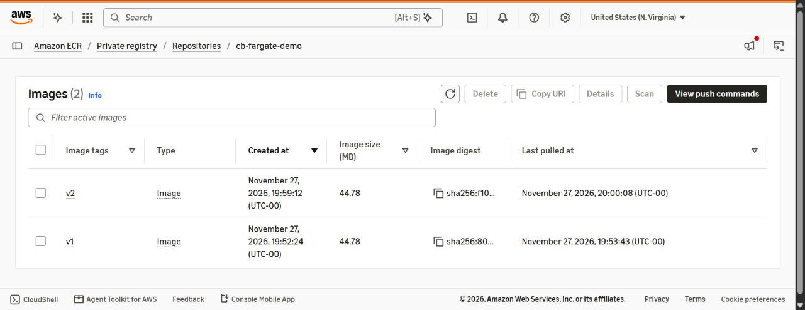
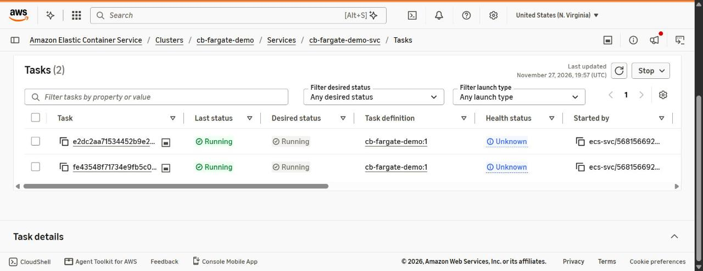
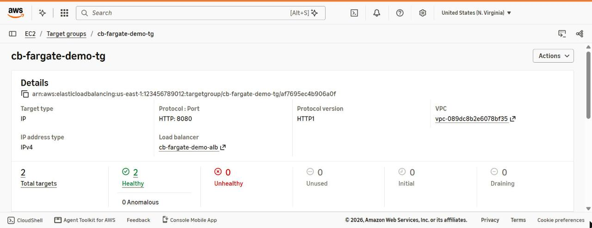
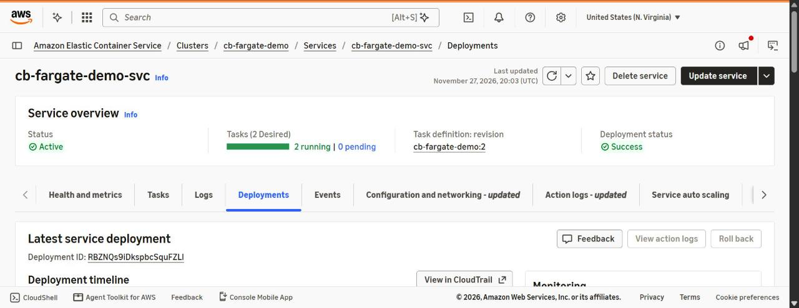
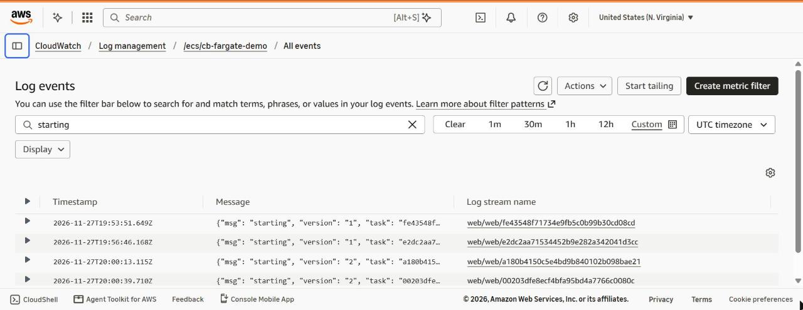

# Containerized Web App on AWS: Amazon ECR + ECS Fargate + Application Load Balancer

A small Python web app packaged as a container, stored in Amazon ECR, and run as two AWS Fargate (ARM64) tasks behind an Application Load Balancer, with zero-downtime rolling deployments.

```
Browser ──HTTP──▶ ALB (/health checks) ──:8080 (ALB SG only)──▶ ECS Service on Fargate (2 tasks)
                                                                  ├─ image from ECR
                                                                  └─ logs to CloudWatch
```

## Highlights

- **Fargate ARM64 (Graviton)** at the smallest size (0.25 vCPU / 512 MB).
- **Security groups:** tasks accept traffic only from the ALB.
- **Rolling deployments** (`min 100% / max 200%`) with the **deployment circuit breaker** and automatic rollback.
- **Fast drains:** target group deregistration delay set to 10 s.
- Image from **ECR Public** base, runs as a **non-root** user, scanned on push.
- Optional **CodeBuild** build (`buildspec.yml`) when Docker isn't available locally.

## Files

| File | Purpose |
|------|---------|
| [`app/app.py`](app/app.py) | Web app (`/`, `/health`, `/api/info` with version and task ID) |
| [`app/Dockerfile`](app/Dockerfile) | Container image |
| [`app/buildspec.yml`](app/buildspec.yml) | CodeBuild build-and-push |
| [`deploy.sh`](deploy.sh) | Builds, pushes and deploys everything (needs Docker) |
| [`cleanup.sh`](cleanup.sh) | Deletes everything |
| [`screenshots/`](screenshots) | Console screenshots from a real deployment |

## Deploy

```bash
./deploy.sh                 # VERSION=2 to build a different version tag
```

## Results from the real run

- First healthy response about 3 minutes after creating the service.
- Requests alternate between the two tasks.
- Rolling update v1 to v2: 183 seconds, **0 failed requests** (polled every 4 seconds).

## Screenshots

| ECR images | ECS tasks |
|---|---|
|  |  |

| Target group | Deployment |
|---|---|
|  |  |



## Cost

Roughly **$1.50/day** if left running (ALB + 2 tasks + public IPv4). Run `./cleanup.sh` when done.

## Blog post

A full step-by-step walkthrough is in [BLOG.md](BLOG.md).
