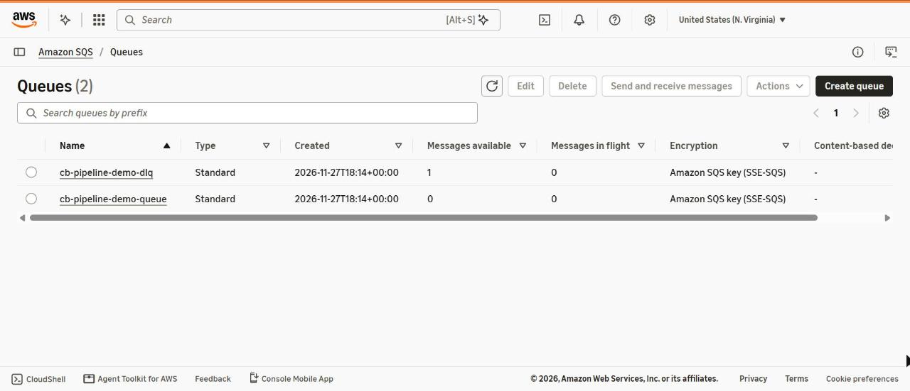
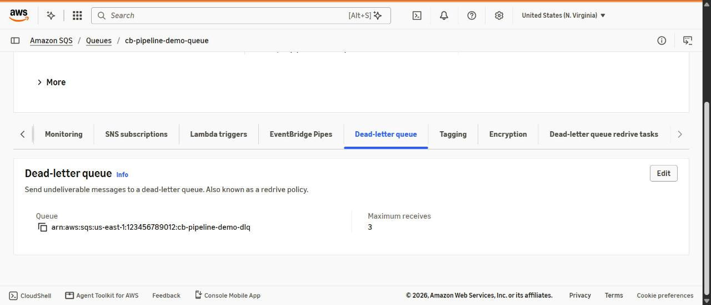
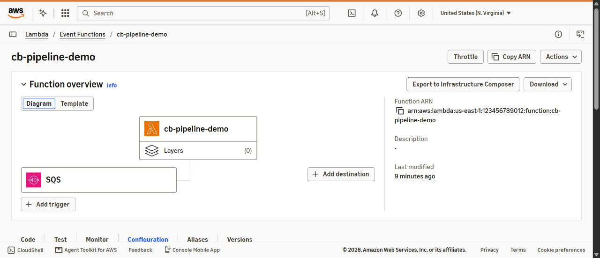
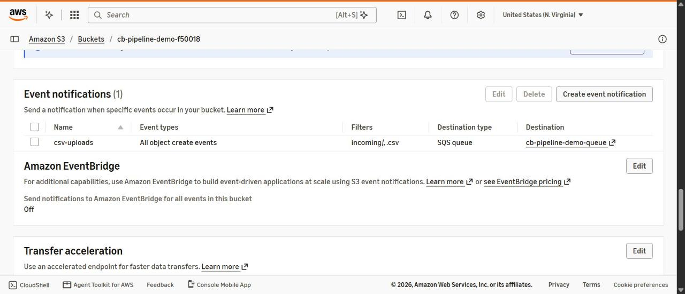
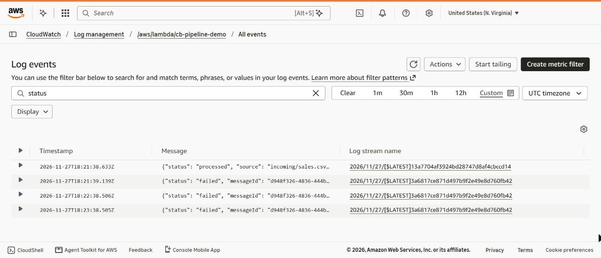
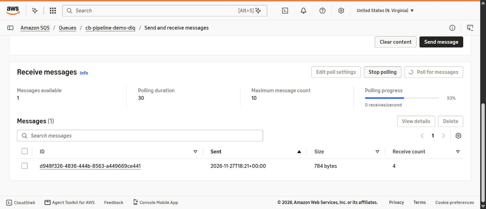

# Build an Event-Driven File Processing Pipeline on AWS with S3, Lambda and SQS (Step by Step)


"When a file lands in S3, do something with it" is one of the most common serverless requirements I come across. The quickest way is to point an S3 event straight at a Lambda function, but that version has a weak spot: if processing fails, the event is retried a couple of times and then quietly gone.

In this post I'm building a sturdier version. Uploads go into an **Amazon SQS queue** first, **AWS Lambda** processes them in batches, failed files are retried automatically, and anything that keeps failing lands in a **dead-letter queue (DLQ)** where I can inspect it instead of losing it. I'm testing it with one good file and one deliberately broken file so you can see both paths.

## What I'm building

```
Upload CSV ──▶ S3 bucket (incoming/)
                  │  event notification
                  ▼
              SQS queue ──(fails 3 times)──▶ Dead-letter queue
                  │  batches of up to 10
                  ▼
              Lambda (Python 3.12) ──▶ S3 bucket (processed/*.json)
                  │
                  ▼
              CloudWatch Logs
```

The Lambda function reads a sales CSV (`item,quantity,price`), adds up the quantities and revenue, and writes a JSON summary to `processed/`.

**Why put a queue in the middle?**

- **Durability:** messages wait in SQS (up to 14 days) even if the function is failing or throttled.
- **Retries you control:** the visibility timeout and `maxReceiveCount` decide how often a message is retried.
- **A place for failures:** the DLQ keeps poison messages for inspection instead of dropping them.
- **Batching:** Lambda pulls up to 10 messages per invocation, which means fewer invocations.

**Prerequisites:** an AWS account and the AWS CLI v2 configured. I'm using `us-east-1`.

```bash
export REGION=us-east-1
export NAME=cb-pipeline-demo
export BUCKET=$NAME-$(date +%s | tail -c 7)
export ACCOUNT_ID=$(aws sts get-caller-identity --query Account --output text)
```

## Step 1: Create a private bucket

```bash
aws s3api create-bucket --bucket $BUCKET --region $REGION
aws s3api put-public-access-block --bucket $BUCKET \
  --public-access-block-configuration \
  BlockPublicAcls=true,IgnorePublicAcls=true,BlockPublicPolicy=true,RestrictPublicBuckets=true
```

## Step 2: Create the dead-letter queue and the main queue

The DLQ is just a normal queue. I give it the maximum retention (14 days) so failed messages have time to be investigated.

```bash
aws sqs create-queue --queue-name $NAME-dlq \
  --attributes MessageRetentionPeriod=1209600
```

The main queue needs three things:

- **`VisibilityTimeout: 60`**: while Lambda works on a message, it's hidden from other consumers. AWS recommends at least **6× the function timeout**; my function timeout is 10 seconds.
- **`RedrivePolicy`**: after **3** failed receives, SQS moves the message to the DLQ.
- **A queue policy** that lets *only my bucket* send messages to it.

```bash
QUEUE_ARN=arn:aws:sqs:$REGION:$ACCOUNT_ID:$NAME-queue
DLQ_ARN=arn:aws:sqs:$REGION:$ACCOUNT_ID:$NAME-dlq

cat > queue-attrs.json <<EOF
{
  "VisibilityTimeout": "60",
  "RedrivePolicy": "{\"deadLetterTargetArn\":\"$DLQ_ARN\",\"maxReceiveCount\":\"3\"}",
  "Policy": "{\"Version\":\"2012-10-17\",\"Statement\":[{\"Effect\":\"Allow\",\"Principal\":{\"Service\":\"s3.amazonaws.com\"},\"Action\":\"sqs:SendMessage\",\"Resource\":\"$QUEUE_ARN\",\"Condition\":{\"ArnEquals\":{\"aws:SourceArn\":\"arn:aws:s3:::$BUCKET\"},\"StringEquals\":{\"aws:SourceAccount\":\"$ACCOUNT_ID\"}}}]}"
}
EOF

aws sqs create-queue --queue-name $NAME-queue --attributes file://queue-attrs.json
```

The `aws:SourceAccount` condition is worth keeping: bucket names are global, so it guards against a bucket with the same name in someone else's account.





## Step 3: Create a least-privilege IAM role

The function can read from `incoming/`, write to `processed/`, and consume from the main queue, and nothing else.

```bash
aws iam create-role --role-name $NAME-role --assume-role-policy-document '{
  "Version": "2012-10-17",
  "Statement": [{"Effect": "Allow", "Principal": {"Service": "lambda.amazonaws.com"}, "Action": "sts:AssumeRole"}]}'

aws iam attach-role-policy --role-name $NAME-role \
  --policy-arn arn:aws:iam::aws:policy/service-role/AWSLambdaBasicExecutionRole

aws iam put-role-policy --role-name $NAME-role --policy-name pipeline-access --policy-document "{
  \"Version\": \"2012-10-17\",
  \"Statement\": [
    {\"Effect\": \"Allow\", \"Action\": [\"sqs:ReceiveMessage\",\"sqs:DeleteMessage\",\"sqs:GetQueueAttributes\"], \"Resource\": \"$QUEUE_ARN\"},
    {\"Effect\": \"Allow\", \"Action\": \"s3:GetObject\", \"Resource\": \"arn:aws:s3:::$BUCKET/incoming/*\"},
    {\"Effect\": \"Allow\", \"Action\": \"s3:PutObject\", \"Resource\": \"arn:aws:s3:::$BUCKET/processed/*\"}
  ]}"
```

Splitting read and write by prefix also prevents a classic accident: if the function could write to `incoming/`, a bug could trigger itself in an endless loop.

## Step 4: Write the Lambda function

Two details make this function production-friendly:

1. **Partial batch responses.** Lambda receives up to 10 messages at once. If one fails, I return only that message's ID in `batchItemFailures`. The successful ones are deleted, and only the failed one goes back to the queue. Without this, one bad file would make the whole batch retry.
2. **The S3 test event.** When you create the notification, S3 sends a one-off `s3:TestEvent` message. It has no `Records`, so the loop simply skips it.

`app.py`:

```python
import csv, io, json, os
from decimal import Decimal, InvalidOperation
from urllib.parse import unquote_plus

import boto3

s3 = boto3.client("s3")
OUTPUT_PREFIX = os.environ.get("OUTPUT_PREFIX", "processed/")


def summarize(bucket, key):
    """Read a sales CSV (item,quantity,price) and return a summary dict."""
    body = s3.get_object(Bucket=bucket, Key=key)["Body"].read().decode("utf-8")
    rows = list(csv.DictReader(io.StringIO(body)))
    if not rows:
        raise ValueError(f"{key} has no data rows")

    total_qty, revenue = 0, Decimal("0")
    for i, row in enumerate(rows, start=2):  # line 1 is the header
        try:
            qty = int(row["quantity"])
            price = Decimal(row["price"])
        except (KeyError, ValueError, InvalidOperation):
            raise ValueError(f"{key} line {i}: bad row {row}")
        total_qty += qty
        revenue += qty * price

    return {
        "source": key,
        "rows": len(rows),
        "total_quantity": total_qty,
        "total_revenue": str(revenue.quantize(Decimal("0.01"))),
    }


def handler(event, context):
    failures = []
    for record in event["Records"]:
        try:
            s3_event = json.loads(record["body"])
            # S3 sends a one-off s3:TestEvent when the notification is created
            for r in s3_event.get("Records", []):
                bucket = r["s3"]["bucket"]["name"]
                key = unquote_plus(r["s3"]["object"]["key"])
                summary = summarize(bucket, key)
                out_key = OUTPUT_PREFIX + os.path.basename(key).rsplit(".", 1)[0] + ".json"
                s3.put_object(Bucket=bucket, Key=out_key,
                              Body=json.dumps(summary, indent=2),
                              ContentType="application/json")
                print(json.dumps({"status": "processed", **summary, "output": out_key}))
        except Exception as e:
            print(json.dumps({"status": "failed", "messageId": record["messageId"], "error": str(e)}))
            failures.append({"itemIdentifier": record["messageId"]})

    # Only the failed messages go back to the queue (partial batch response)
    return {"batchItemFailures": failures}
```

Note the `unquote_plus`: S3 URL-encodes object keys in events, so a file called `my sales.csv` arrives as `my+sales.csv`.

Deploy it:

```bash
zip function.zip app.py

aws lambda create-function --function-name $NAME \
  --runtime python3.12 --architectures arm64 --handler app.handler \
  --zip-file fileb://function.zip --role arn:aws:iam::$ACCOUNT_ID:role/$NAME-role \
  --timeout 10 --memory-size 128 --environment "Variables={OUTPUT_PREFIX=processed/}"
```

## Step 5: Connect the queue to Lambda

The event source mapping is what makes Lambda poll the queue. `ReportBatchItemFailures` turns on the partial batch behaviour from Step 4. **If you forget this flag, `batchItemFailures` is ignored**, which is an easy mistake to miss.

```bash
aws lambda create-event-source-mapping --function-name $NAME \
  --event-source-arn $QUEUE_ARN \
  --batch-size 10 --maximum-batching-window-in-seconds 5 \
  --function-response-types ReportBatchItemFailures
```



## Step 6: Send S3 upload events to the queue

Only `.csv` files under `incoming/` should trigger processing:

```bash
aws s3api put-bucket-notification-configuration --bucket $BUCKET \
  --notification-configuration "{
    \"QueueConfigurations\": [{
      \"Id\": \"csv-uploads\",
      \"QueueArn\": \"$QUEUE_ARN\",
      \"Events\": [\"s3:ObjectCreated:*\"],
      \"Filter\": {\"Key\": {\"FilterRules\": [
        {\"Name\": \"prefix\", \"Value\": \"incoming/\"},
        {\"Name\": \"suffix\", \"Value\": \".csv\"}]}}
    }]}"
```



> ⚠️ **Real-world gotcha:** my first two uploads, made within seconds of creating the notification, never reached the queue. The configuration takes a few minutes to propagate. After waiting a couple of minutes, every upload worked. If your first test does nothing, wait and upload again before you start debugging.

## Step 7: Test the happy path

`sales.csv`:

```
item,quantity,price
Notebook,12,3.50
Pen,40,0.80
Backpack,3,24.99
Water bottle,7,9.25
Desk lamp,2,18.00
```

```bash
aws s3 cp sales.csv s3://$BUCKET/incoming/
# a few seconds later:
aws s3 cp s3://$BUCKET/processed/sales.json -
```

```json
{
  "source": "incoming/sales.csv",
  "rows": 5,
  "total_quantity": 64,
  "total_revenue": "249.72"
}
```

## Step 8: Test the failure path

`broken.csv` has a word where a number should be:

```
item,quantity,price
Notebook,12,3.50
Pen,forty,0.80
```

```bash
aws s3 cp broken.csv s3://$BUCKET/incoming/
```

Here's what happened, straight from CloudWatch Logs: one successful run for `sales.csv`, then three failures for `broken.csv`, **exactly 60 seconds apart**, which is the visibility timeout at work.



After the third failure, SQS moved the message to the dead-letter queue, and the main queue was empty again:

```bash
aws sqs get-queue-attributes --queue-url $(aws sqs get-queue-url --queue-name $NAME-dlq --query QueueUrl --output text) \
  --attribute-names ApproximateNumberOfMessages
# "ApproximateNumberOfMessages": "1"
```



The receive count shows 4: three Lambda attempts plus the one I made when polling it in the console.

## Step 9: Fix and redrive

Once the cause is fixed (here, correcting the file and re-uploading it), messages in a DLQ can be moved back to the source queue with a **redrive**:

```bash
aws sqs start-message-move-task \
  --source-arn $DLQ_ARN \
  --destination-arn $QUEUE_ARN
```

For a bad *file*, re-uploading the corrected version is usually simpler. Redrive is the right tool when the *code* was the problem and the original messages are still valid.

## What does this cost?

For a demo or a low-volume pipeline: **effectively nothing.**

- **SQS:** the first 1 million requests per month are free. Lambda's long polling keeps the request count low.
- **Lambda:** 1M requests and 400,000 GB-seconds free per month; each run here took about 20 ms.
- **S3:** a few small files and event notifications cost a fraction of a cent.

## Clean up

```bash
for UUID in $(aws lambda list-event-source-mappings --function-name $NAME \
    --query "EventSourceMappings[].UUID" --output text); do
  aws lambda delete-event-source-mapping --uuid $UUID
done
aws lambda delete-function --function-name $NAME
aws logs delete-log-group --log-group-name /aws/lambda/$NAME
aws sqs delete-queue --queue-url $(aws sqs get-queue-url --queue-name $NAME-queue --query QueueUrl --output text)
aws sqs delete-queue --queue-url $(aws sqs get-queue-url --queue-name $NAME-dlq --query QueueUrl --output text)
aws iam delete-role-policy --role-name $NAME-role --policy-name pipeline-access
aws iam detach-role-policy --role-name $NAME-role \
  --policy-arn arn:aws:iam::aws:policy/service-role/AWSLambdaBasicExecutionRole
aws iam delete-role --role-name $NAME-role
aws s3 rm s3://$BUCKET --recursive
aws s3api delete-bucket --bucket $BUCKET
```

## Where to go next

- Add a **CloudWatch alarm** on the DLQ's `ApproximateNumberOfMessagesVisible` so a failure pages you instead of waiting to be noticed.
- Make processing **idempotent** (for example, by tracking processed object ETags in DynamoDB), because SQS delivers *at least once*.
- Fan out with **SNS or EventBridge** when more than one consumer needs the same upload event.
- Package the whole pipeline with **AWS SAM** or the **AWS CDK** so it deploys with one command.
