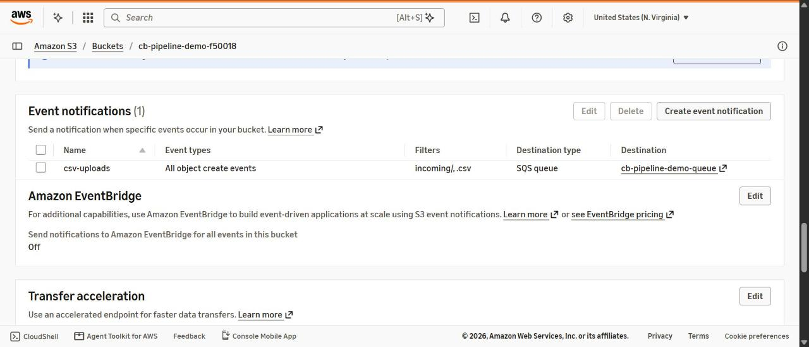
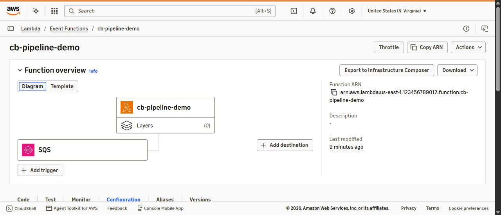
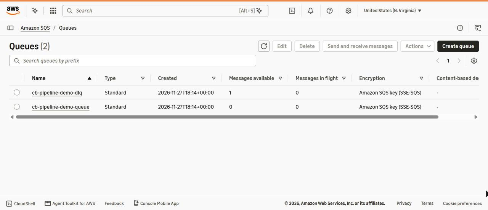
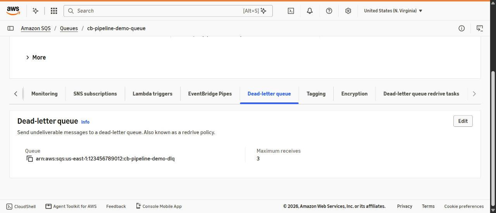
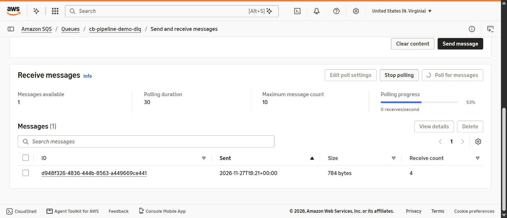
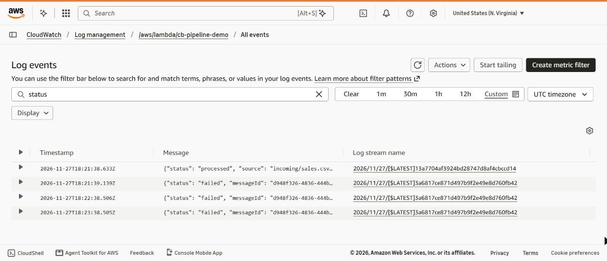

# Event-Driven File Processing Pipeline: Amazon S3 + SQS + AWS Lambda

Upload a CSV to S3 and it's processed automatically. Events are buffered in SQS, processed by Lambda in batches, retried on failure, and moved to a dead-letter queue (DLQ) if they keep failing.

```
S3 (incoming/*.csv) ──event──▶ SQS ──batch──▶ Lambda ──▶ S3 (processed/*.json)
                                 └──(3 failed receives)──▶ DLQ
```

## Highlights

- **SQS buffer** between S3 and Lambda for durability and controlled retries.
- **Dead-letter queue** (`maxReceiveCount: 3`) so bad files are kept, not lost.
- **Partial batch responses** (`ReportBatchItemFailures`): one bad file doesn't retry the whole batch.
- **Least-privilege IAM:** read `incoming/`, write `processed/`, consume one queue.
- **Queue policy** scoped to the bucket ARN and account.

## Files

| File | Purpose |
|------|---------|
| [`app.py`](app.py) | Lambda handler (CSV summary + partial batch failures) |
| [`sample-data/`](sample-data) | `sales.csv` (valid) and `broken.csv` (invalid) |
| [`deploy.sh`](deploy.sh) | Creates bucket, queues, role, function, trigger and notification |
| [`cleanup.sh`](cleanup.sh) | Deletes everything |
| [`screenshots/`](screenshots) | Console screenshots from a real deployment |

## Deploy and test

```bash
./deploy.sh
source .deploy.env
# wait a couple of minutes for the S3 notification to propagate, then:
aws s3 cp sample-data/sales.csv  s3://$BUCKET/incoming/
aws s3 cp sample-data/broken.csv s3://$BUCKET/incoming/
aws s3 cp s3://$BUCKET/processed/sales.json -
```

`broken.csv` is retried 3 times (60 s visibility timeout) and then lands in the DLQ.

## Screenshots

| S3 event notification | Lambda with SQS trigger |
|---|---|
|  |  |

| Queues | Redrive policy |
|---|---|
|  |  |

| Message in the DLQ | CloudWatch Logs |
|---|---|
|  |  |

## Clean up

```bash
./cleanup.sh
```

## Blog post

A full walkthrough is in [BLOG.md](BLOG.md).
