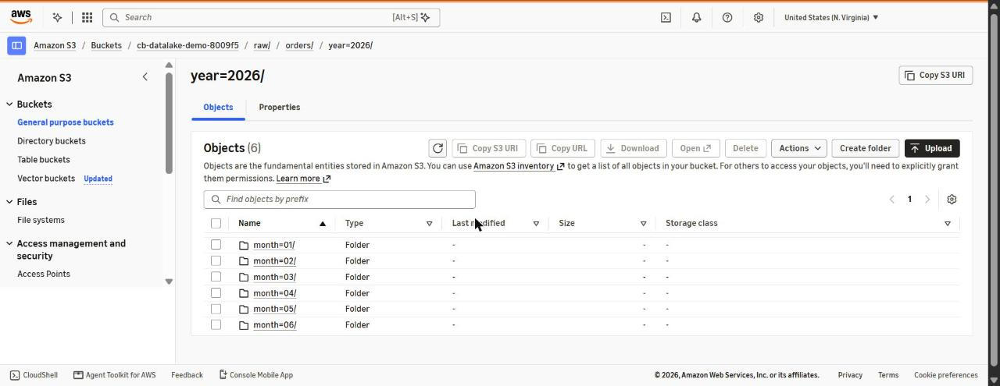
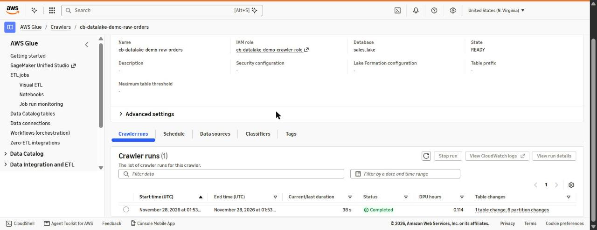
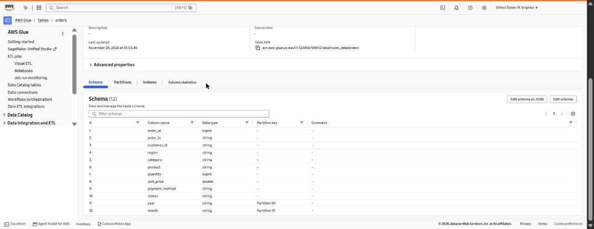
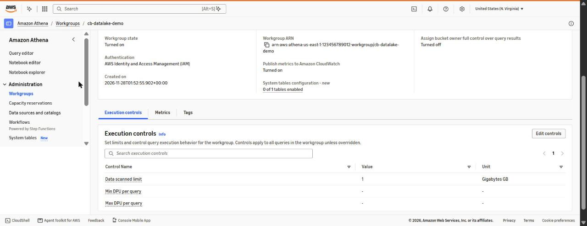
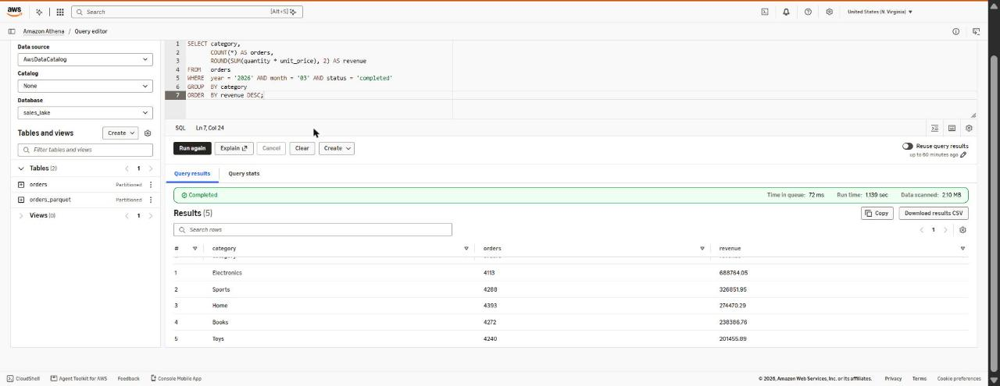
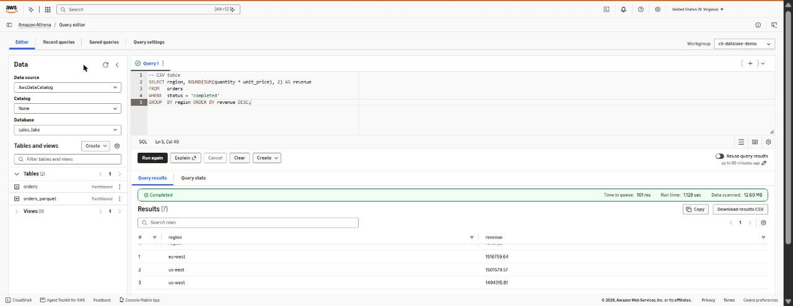
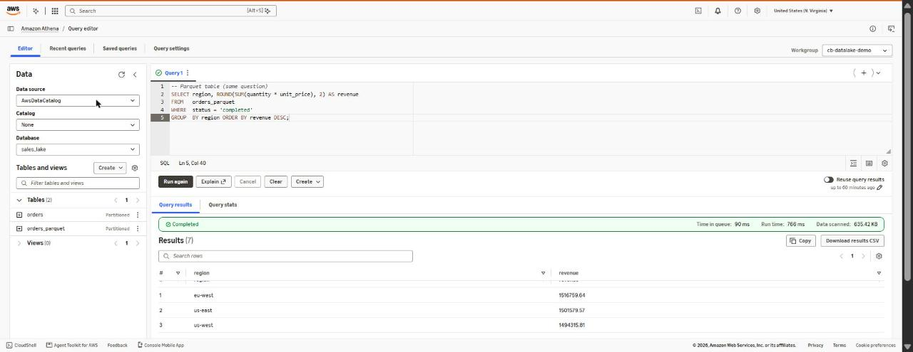

I wanted to answer questions like "which product category made the most money in March?" from a pile of CSV files, without standing up a database or a cluster. On AWS the answer is a small **serverless data lake**: the files stay in **Amazon S3**, an **AWS Glue crawler** works out the schema, and **Amazon Athena** runs plain SQL against them. There's nothing to keep running, and I only pay for the data each query reads.

In this post I'm building one with 150,000 synthetic e-commerce orders. Then I'm converting the data to **Parquet** and running the same query again. It read **about 95% less data** (12.6 MB down to 635 KB) and returned exactly the same answer.

## What I'm building

```
sample CSVs ──▶ S3  raw/orders/year=2026/month=01..06/   (Hive-style partitions)
                 │
                 ▼
         Glue crawler ──▶ Glue Data Catalog (database: sales_lake, table: orders)
                                   │
                                   ▼
                         Athena workgroup (1 GB per-query scan limit)
                                   │  CTAS
                                   ▼
               S3  curated/orders/  (Parquet + Snappy) ──▶ table: orders_parquet
```

- **S3** stores the raw files and the optimised copy.
- **Glue crawler** reads the files and creates a table definition, including the partitions.
- **Glue Data Catalog** is the metastore that Athena reads table definitions from.
- **Athena** runs SQL directly on S3 and charges per byte scanned.

**Prerequisites:** an AWS account, the AWS CLI v2 configured, and Python 3 to generate the sample data. I'm using `us-east-1`.

```bash
export REGION=us-east-1 AWS_DEFAULT_REGION=us-east-1
export NAME=cb-datalake-demo
export BUCKET=$NAME-$(date +%s | tail -c 7)
export DB=sales_lake
export ACCOUNT_ID=$(aws sts get-caller-identity --query Account --output text)
```

## Step 1: Generate some data

I wrote a small script that creates six months of fake orders, 25,000 per month. Each order has an ID, timestamp, customer, region, category, product, quantity, unit price, payment method and status.

The important part is the **folder layout**. Each month goes into its own `year=YYYY/month=MM/` folder:

```
sample-data/orders/year=2026/month=01/orders.csv
sample-data/orders/year=2026/month=02/orders.csv
...
sample-data/orders/year=2026/month=06/orders.csv
```

This `key=value` naming is called **Hive-style partitioning**. Glue recognises it and turns `year` and `month` into columns. Athena can then skip whole folders when a query filters on them.

```bash
python3 scripts/generate_orders.py
head -3 sample-data/orders/year=2026/month=01/orders.csv
```

```
order_id,order_ts,customer_id,region,category,product,quantity,unit_price,payment_method,status
100001,2026-01-14 08:25:56,C02007,us-west,Electronics,Headphones,1,81.92,bank_transfer,completed
100002,2026-01-02 13:01:46,C00245,us-east,Toys,Building Blocks,1,45.05,card,returned
```

That's about 13 MB of CSV in total.

## Step 2: Create a private bucket and upload the raw data

```bash
aws s3api create-bucket --bucket $BUCKET
aws s3api put-public-access-block --bucket $BUCKET \
  --public-access-block-configuration \
  BlockPublicAcls=true,IgnorePublicAcls=true,BlockPublicPolicy=true,RestrictPublicBuckets=true

# Athena writes a result file for every query. Expire those after 7 days.
aws s3api put-bucket-lifecycle-configuration --bucket $BUCKET --lifecycle-configuration '{
  "Rules": [{"ID": "expire-athena-results", "Status": "Enabled",
             "Filter": {"Prefix": "athena-results/"}, "Expiration": {"Days": 7}}]}'

aws s3 cp sample-data/orders s3://$BUCKET/raw/orders/ --recursive
```

I'm using three prefixes in one bucket:

| Prefix | Contents |
|---|---|
| `raw/` | Data exactly as it arrived (CSV) |
| `curated/` | Cleaned, query-optimised copy (Parquet) |
| `athena-results/` | Query output files, expired after 7 days |



## Step 3: Create a Glue database and a crawler role

The Glue Data Catalog database is only a namespace for tables:

```bash
aws glue create-database --database-input "{\"Name\": \"$DB\"}"
```

The crawler needs an IAM role. I attach the AWS managed `AWSGlueServiceRole` policy for the Glue basics. Then I add an inline policy that lets it read **only** the `raw/` prefix:

```bash
aws iam create-role --role-name $NAME-crawler-role --assume-role-policy-document '{
  "Version": "2012-10-17",
  "Statement": [{"Effect": "Allow", "Principal": {"Service": "glue.amazonaws.com"},
                 "Action": "sts:AssumeRole"}]}'

aws iam attach-role-policy --role-name $NAME-crawler-role \
  --policy-arn arn:aws:iam::aws:policy/service-role/AWSGlueServiceRole

aws iam put-role-policy --role-name $NAME-crawler-role --policy-name read-raw --policy-document "{
  \"Version\": \"2012-10-17\",
  \"Statement\": [
    {\"Effect\": \"Allow\", \"Action\": \"s3:GetObject\",
     \"Resource\": \"arn:aws:s3:::$BUCKET/raw/*\"},
    {\"Effect\": \"Allow\", \"Action\": \"s3:ListBucket\",
     \"Resource\": \"arn:aws:s3:::$BUCKET\",
     \"Condition\": {\"StringLike\": {\"s3:prefix\": [\"raw/*\"]}}}
  ]}"
```

## Step 4: Run the crawler

I point the crawler at the `orders/` folder, not at each month. That way it creates **one** table with partitions instead of six separate tables:

```bash
aws glue create-crawler --name $NAME-raw-orders --database-name $DB \
  --role arn:aws:iam::$ACCOUNT_ID:role/$NAME-crawler-role \
  --targets "{\"S3Targets\": [{\"Path\": \"s3://$BUCKET/raw/orders/\"}]}" \
  --schema-change-policy UpdateBehavior=UPDATE_IN_DATABASE,DeleteBehavior=LOG \
  --configuration '{"Version":1.0,"Grouping":{"TableGroupingPolicy":"CombineCompatibleSchemas"}}'

aws glue start-crawler --name $NAME-raw-orders
```

`CombineCompatibleSchemas` tells the crawler to merge files with matching columns into a single table. `DeleteBehavior=LOG` means it only logs a removed folder and never drops a table on its own.

In my run the crawler finished in **38 seconds**: 1 table created, 6 partitions added.



The resulting `orders` table has the 10 CSV columns with sensible types (`bigint`, `double`, `string`) plus `year` and `month` as partition keys. The crawler also spotted the header row and set `skip.header.line.count = 1`, so the header isn't read as data.



> `order_ts` came through as `string`, because the crawler doesn't parse timestamps in CSV. I'll fix that in Step 7.

## Step 5: Create an Athena workgroup with a scan limit

Athena charges **$5 per TB scanned**. A forgotten `SELECT *` on a large table can get expensive, so I create a dedicated workgroup with two things set:

- a **result location** in my bucket
- a **per-query scan limit of 1 GB**. Any query that would read more is cancelled.

```bash
aws athena create-work-group --name $NAME --configuration "{
  \"ResultConfiguration\": {\"OutputLocation\": \"s3://$BUCKET/athena-results/\"},
  \"EnforceWorkGroupConfiguration\": false,
  \"PublishCloudWatchMetricsEnabled\": true,
  \"BytesScannedCutoffPerQuery\": 1073741824
}"
```



**A gotcha I hit:** I first created the workgroup with `EnforceWorkGroupConfiguration: true`. That forces every query to use the workgroup's output location. The `CREATE TABLE AS` in Step 7 then failed:

```
The Create Table As Select query failed because it was submitted with an
'external_location' property to an Athena Workgroup that enforces a
centralized output location for all queries.
```

Setting it to `false` fixed it. The scan limit still applies either way.

## Step 6: Query the data with SQL

Now for the fun part. Revenue by category for March:

```sql
SELECT category,
       COUNT(*)                             AS orders,
       ROUND(SUM(quantity * unit_price), 2) AS revenue
FROM   orders
WHERE  year = '2026' AND month = '03' AND status = 'completed'
GROUP  BY category
ORDER  BY revenue DESC;
```



Look at **Data scanned: 2.10 MB**. The whole dataset is 12.6 MB, but because the query filters on the `year` and `month` partition columns, Athena only opened the `month=03` folder. That's **partition pruning**, and it's the cheapest optimisation there is.

You can run the queries from the CLI too. The repo has a small `run-query.sh` helper that starts the query, waits for it, and prints the results with the bytes scanned:

```bash
./run-query.sh queries/02-monthly-trend.sql
```

| month | orders | revenue | avg order value |
|---|---|---|---|
| 01 | 21,188 | 1,734,201.87 | 81.85 |
| 02 | 21,260 | 1,733,560.56 | 81.54 |
| 03 | 21,306 | 1,729,928.94 | 81.19 |
| 04 | 21,260 | 1,729,625.91 | 81.36 |
| 05 | 21,190 | 1,746,987.50 | 82.44 |
| 06 | 21,336 | 1,750,155.85 | 82.03 |

## Step 7: Convert to Parquet with CTAS

CSV is easy to produce but expensive to query. Athena has to read every byte of every row, even when the query only needs two columns.

**Parquet** is a columnar, compressed format. Athena reads only the columns a query uses, and it can skip blocks of rows using the min and max statistics stored in the file.

I don't need a separate ETL job to convert. Athena's `CREATE TABLE AS SELECT` (CTAS) does it in one statement, and I fix the `order_ts` type at the same time:

```sql
CREATE TABLE orders_parquet
WITH (
  format            = 'PARQUET',
  write_compression = 'SNAPPY',
  external_location = 's3://YOUR_BUCKET/curated/orders/',
  partitioned_by    = ARRAY['year', 'month']
) AS
SELECT order_id,
       CAST(order_ts AS timestamp) AS order_ts,
       customer_id, region, category, product,
       quantity, unit_price, payment_method, status,
       year, month           -- partition columns must come last
FROM   orders;
```

It took about 2.4 seconds. The new table is registered in the Glue Data Catalog automatically, with the same partitions, and no crawler run is needed.

On disk, the data went from **13.2 MB of CSV to 3.4 MB of Parquet**.

## Step 8: Compare CSV and Parquet

The same question against both tables: total completed revenue by region.

```sql
SELECT region, ROUND(SUM(quantity * unit_price), 2) AS revenue
FROM   orders            -- then: FROM orders_parquet
WHERE  status = 'completed'
GROUP  BY region ORDER BY revenue DESC;
```

**CSV table:** 12.60 MB scanned.



**Parquet table:** 635.42 KB scanned, with identical results.



| | CSV | Parquet (Snappy) |
|---|---|---|
| Storage | 13.2 MB | 3.4 MB |
| Data scanned (region query) | 12.60 MB | 635 KB |
| Run time | 1.13 s | 0.77 s |
| Relative query cost | 1x | ~0.05x |

The query only touches 4 of the 12 columns (`region`, `quantity`, `unit_price`, `status`), so Parquet reads only those. At 13 MB the saving is fractions of a cent. At 13 TB it's the difference between about $65 and $3 **per query**.

## What does this cost?

For this demo, a few cents:

- **Glue crawler:** $0.44 per DPU-hour, billed per second with a 10-minute minimum, so roughly $0.07 per run.
- **Glue Data Catalog:** the first million objects stored and requests each month are free.
- **Athena:** $5 per TB scanned, with a 10 MB minimum per query. Every query in this post combined scanned well under 1 GB.
- **S3:** about 17 MB stored for an hour, which rounds to zero.

There are no servers, so nothing costs money while I'm not querying.

## Clean up

```bash
aws athena delete-work-group --work-group $NAME --recursive-delete-option
aws glue delete-crawler --name $NAME-raw-orders
aws glue delete-database --name $DB            # also deletes both tables
aws iam delete-role-policy --role-name $NAME-crawler-role --policy-name read-raw
aws iam detach-role-policy --role-name $NAME-crawler-role \
  --policy-arn arn:aws:iam::aws:policy/service-role/AWSGlueServiceRole
aws iam delete-role --role-name $NAME-crawler-role
aws s3 rm s3://$BUCKET --recursive
aws s3api delete-bucket --bucket $BUCKET
```

Deleting the Glue database removes the table *definitions* only. The S3 data is deleted separately, which is why the `s3 rm` is there.

## Where to go next

- **Add new data automatically:** schedule the crawler, or skip it and use **partition projection** so Athena works out partitions from the path without crawling.
- **Convert on arrival:** trigger a Glue job or a Lambda function when new CSVs land, so `curated/` is always up to date.
- **Govern access:** use **AWS Lake Formation** for column- and row-level permissions on the catalog tables.
- **Try Apache Iceberg tables** in Athena when you need updates, deletes and time travel on the lake.
- **Visualise it:** point **Amazon QuickSight** at the Athena tables for dashboards.

The full code, including the data generator, SQL files and deploy/cleanup scripts, is on GitHub: [Qwamzz/AWS-Projects](https://github.com/Qwamzz/AWS-Projects/tree/main/Serverless-Data-Lake-S3-Glue-Athena).
