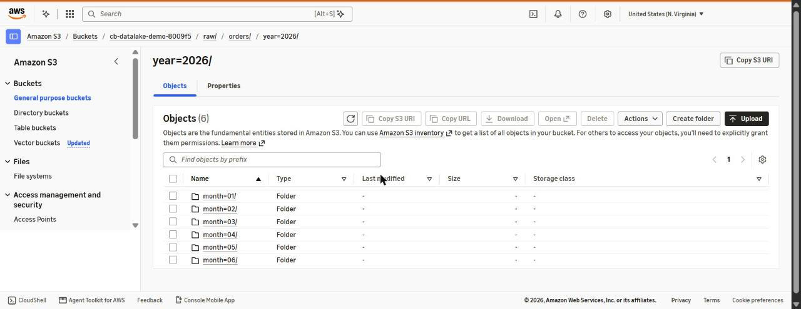
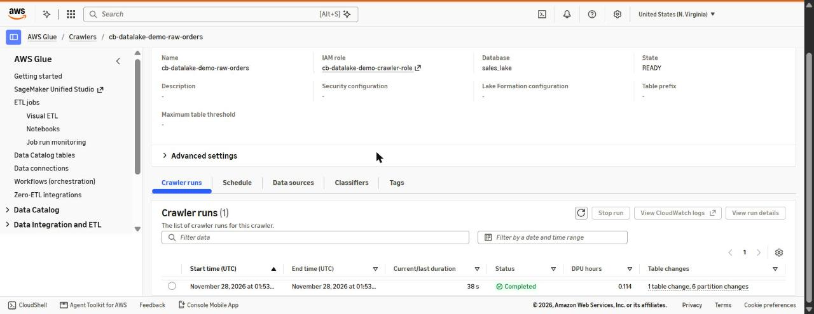
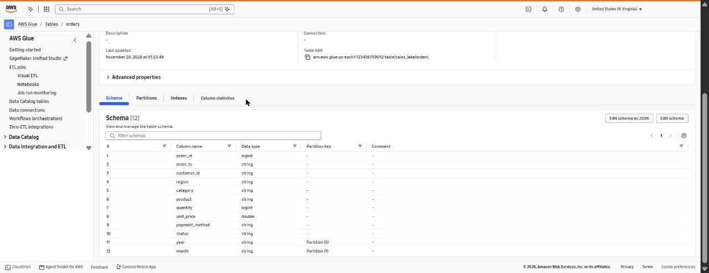
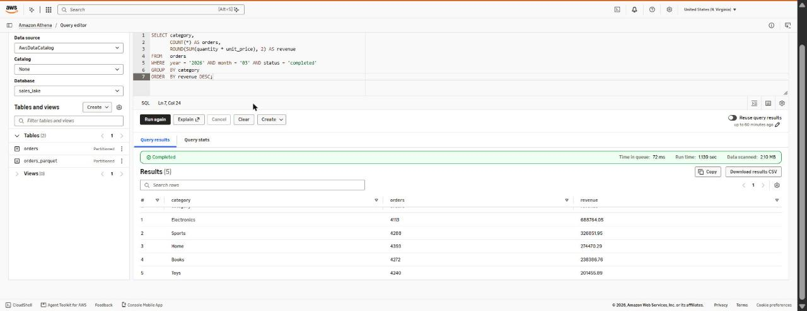
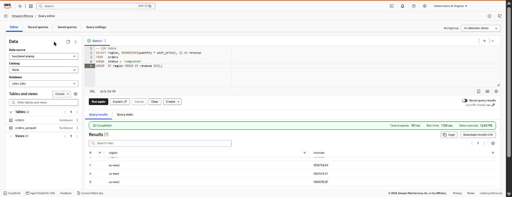
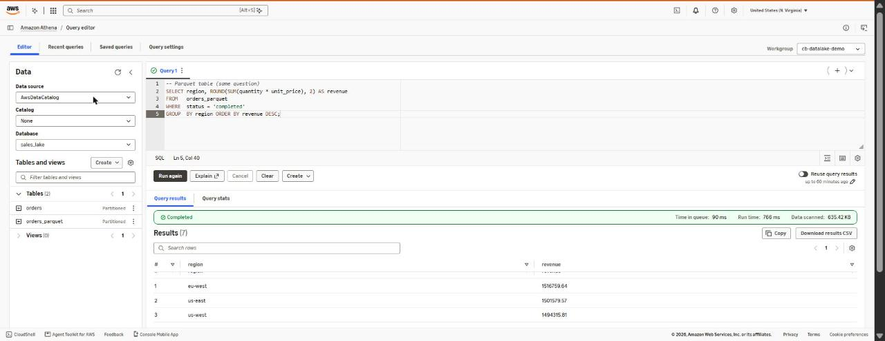
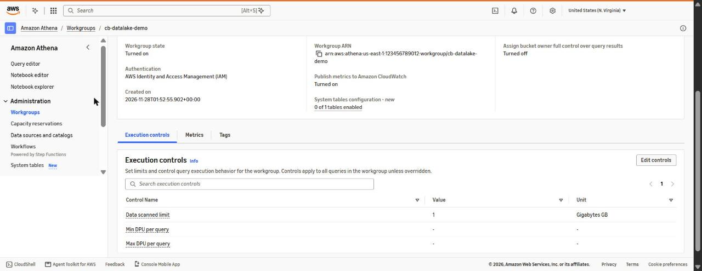

# Serverless Data Lake: Amazon S3 + AWS Glue + Amazon Athena

Query CSV files in S3 with plain SQL, with no database or cluster to run. A Glue crawler builds the table from Hive-style partition folders, Athena queries it, and a CTAS statement converts the data to Parquet to cut the data scanned per query by about 95%.

```
S3 raw/orders/year=2026/month=MM/*.csv ──▶ Glue crawler ──▶ Glue Data Catalog (sales_lake.orders)
                                                                   │
                                                                   ▼
                                            Athena workgroup (1 GB per-query scan limit)
                                                                   │ CTAS
                                                                   ▼
                              S3 curated/orders/ (Parquet + Snappy) ──▶ sales_lake.orders_parquet
```

## Highlights

- **Hive-style partitions** (`year=/month=`) so queries filtering on month read only that folder.
- **Least-privilege crawler role:** reads only the `raw/` prefix.
- **Athena workgroup** with a 1 GB per-query scan limit and CloudWatch metrics.
- **CTAS to Parquet (Snappy)**, which also fixes the timestamp type.
- **Lifecycle rule** that expires Athena result files after 7 days.

## Files

| File | Purpose |
|------|---------|
| [`scripts/generate_orders.py`](scripts/generate_orders.py) | Generates 150,000 synthetic orders as partitioned CSV |
| [`queries/`](queries) | The SQL used in the post |
| [`deploy.sh`](deploy.sh) | Creates the bucket, uploads data, runs the crawler, creates the workgroup |
| [`run-query.sh`](run-query.sh) | Runs a SQL file in Athena and prints results and data scanned |
| [`cleanup.sh`](cleanup.sh) | Deletes everything |
| [`screenshots/`](screenshots) | Console screenshots from a real deployment |

## Deploy and query

```bash
./deploy.sh
./run-query.sh queries/01-revenue-by-category.sql
./run-query.sh queries/03-ctas-parquet.sql
./run-query.sh queries/04-region-revenue-csv-vs-parquet.sql
```

## Results from the real run

| | CSV | Parquet (Snappy) |
|---|---|---|
| Storage | 13.2 MB | 3.4 MB |
| Data scanned (region revenue query) | 12.60 MB | 635 KB |
| Data scanned (one month, partition filter) | 2.10 MB | - |

The crawler took 38 seconds and created 1 table with 6 partitions.

## Screenshots

| Partitioned raw data | Crawler run |
|---|---|
|  |  |

| Table schema | Partition-pruned query |
|---|---|
|  |  |

| CSV scan | Parquet scan |
|---|---|
|  |  |



## Cost

A few cents for the whole demo: about $0.07 per crawler run, and Athena at $5 per TB scanned (10 MB minimum per query). Run `./cleanup.sh` when done.

## Blog post

A full walkthrough is in [BLOG.md](BLOG.md).
