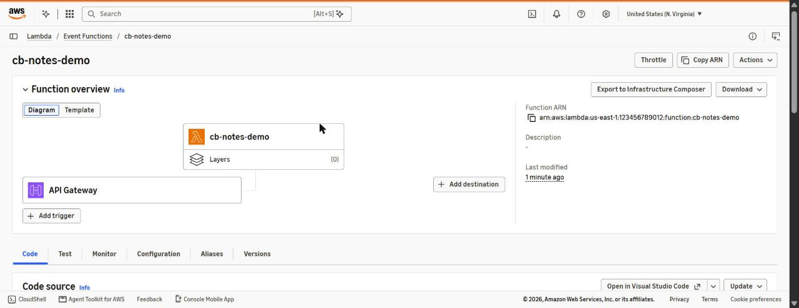
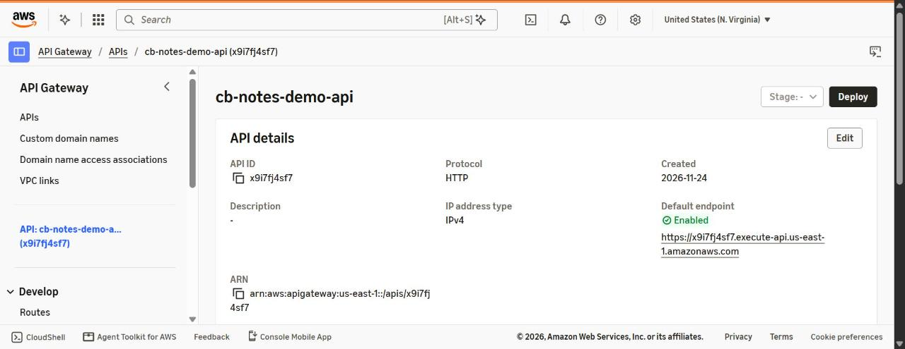
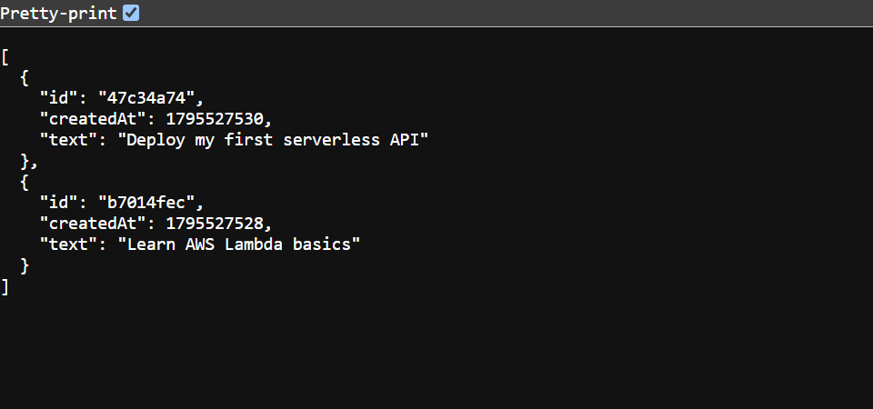
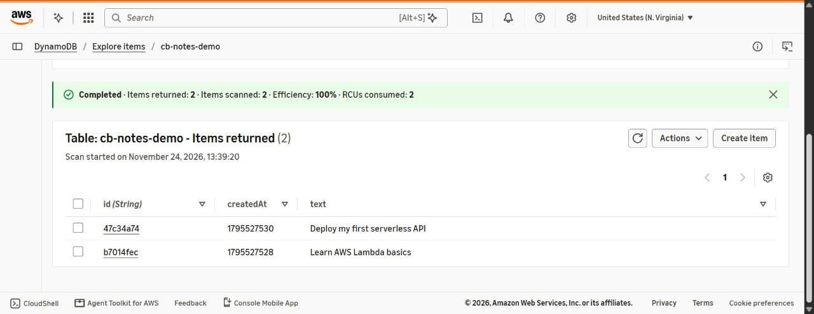

# Build a Serverless Notes API on AWS with Lambda, API Gateway and DynamoDB (Step by Step)


A question I hear a lot from people getting started with AWS is: *"What's the simplest real-world thing I can build to understand serverless?"*

My answer is always the same: **a small REST API**. It touches the three services you'll use in almost every serverless project: **AWS Lambda** for compute, **Amazon API Gateway** for HTTP, and **Amazon DynamoDB** for storage. And it costs next to nothing to run.

In this post I'm building a **Notes API** from scratch with the AWS CLI, testing it with `curl`, checking it in the AWS Console, and then tearing it all down so it doesn't cost a cent.

## What I'm building

```
Client (curl / browser)
        │  HTTPS
        ▼
Amazon API Gateway (HTTP API)
        │  Lambda proxy integration
        ▼
AWS Lambda (Python 3.12, arm64)
        │  boto3
        ▼
Amazon DynamoDB (on-demand table)
```

| Method | Path          | What it does        |
|--------|---------------|---------------------|
| POST   | `/notes`      | Create a note       |
| GET    | `/notes`      | List all notes      |
| GET    | `/notes/{id}` | Get one note        |
| DELETE | `/notes/{id}` | Delete a note       |

**Prerequisites:** an AWS account, the AWS CLI v2 configured (`aws configure`), and `curl`. Everything below runs in `us-east-1`. Change `REGION` if you prefer another one.

```bash
export REGION=us-east-1
export NAME=cb-notes-demo
export ACCOUNT_ID=$(aws sts get-caller-identity --query Account --output text)
```

## Step 1: Create the DynamoDB table

I only need a partition key (`id`). On-demand billing means no capacity planning: you pay per request, and a demo like this stays well inside the free tier.

```bash
aws dynamodb create-table \
  --table-name $NAME \
  --attribute-definitions AttributeName=id,AttributeType=S \
  --key-schema AttributeName=id,KeyType=HASH \
  --billing-mode PAY_PER_REQUEST \
  --region $REGION
```

## Step 2: Create an IAM role for Lambda (least privilege)

The function needs two things: permission to write logs to CloudWatch, and permission to read/write **only this table**.

```bash
aws iam create-role --role-name $NAME-role \
  --assume-role-policy-document '{
    "Version": "2012-10-17",
    "Statement": [{"Effect": "Allow",
                   "Principal": {"Service": "lambda.amazonaws.com"},
                   "Action": "sts:AssumeRole"}]}'

aws iam attach-role-policy --role-name $NAME-role \
  --policy-arn arn:aws:iam::aws:policy/service-role/AWSLambdaBasicExecutionRole

aws iam put-role-policy --role-name $NAME-role --policy-name dynamodb-access \
  --policy-document "{
    \"Version\": \"2012-10-17\",
    \"Statement\": [{\"Effect\": \"Allow\",
      \"Action\": [\"dynamodb:PutItem\",\"dynamodb:GetItem\",\"dynamodb:Scan\",\"dynamodb:DeleteItem\"],
      \"Resource\": \"arn:aws:dynamodb:$REGION:$ACCOUNT_ID:table/$NAME\"}]}"
```

> 💡 Resist the urge to attach `AmazonDynamoDBFullAccess`. Scoping the policy to one table and four actions is a habit worth building early.

## Step 3: Write the Lambda function

One handler routes on the HTTP method and path parameters. API Gateway's **payload format 2.0** gives me `requestContext.http.method` and `pathParameters` directly.

`app.py`:

```python
import json, os, uuid, time, boto3
from decimal import Decimal

table = boto3.resource("dynamodb").Table(os.environ["TABLE_NAME"])


def resp(status, body):
    return {
        "statusCode": status,
        "headers": {"Content-Type": "application/json"},
        "body": json.dumps(body, default=lambda o: int(o) if isinstance(o, Decimal) else str(o)),
    }


def handler(event, context):
    method = event["requestContext"]["http"]["method"]
    params = event.get("pathParameters") or {}

    if method == "POST":
        data = json.loads(event.get("body") or "{}")
        item = {"id": str(uuid.uuid4())[:8], "text": data.get("text", ""), "createdAt": int(time.time())}
        table.put_item(Item=item)
        return resp(201, item)

    if method == "GET" and "id" in params:
        item = table.get_item(Key={"id": params["id"]}).get("Item")
        return resp(200, item) if item else resp(404, {"error": "not found"})

    if method == "GET":
        return resp(200, table.scan().get("Items", []))

    if method == "DELETE" and "id" in params:
        table.delete_item(Key={"id": params["id"]})
        return resp(204, {})

    return resp(400, {"error": "unsupported"})
```

Two details worth calling out:

- **`Decimal` handling:** DynamoDB returns numbers as `Decimal`, which `json.dumps` can't serialize. The `default=` hook converts them.
- **The table is created outside the handler**, so it's reused across warm invocations instead of being rebuilt on every request.

Package and deploy it. I'm using **arm64 (Graviton)** because it's cheaper per GB-second than x86 and works with pure-Python code unchanged:

```bash
zip function.zip app.py

aws lambda create-function --function-name $NAME \
  --runtime python3.12 --architectures arm64 \
  --handler app.handler --zip-file fileb://function.zip \
  --role arn:aws:iam::$ACCOUNT_ID:role/$NAME-role \
  --environment Variables={TABLE_NAME=$NAME} \
  --timeout 10 --memory-size 128 --region $REGION
```

> If you get *"The role defined for the function cannot be assumed by Lambda"*, wait 10 seconds and retry. New IAM roles take a moment to propagate.



## Step 4: Create the HTTP API and routes

HTTP APIs are the lighter, cheaper flavour of API Gateway, which makes them a good fit for Lambda backends.

```bash
API_ID=$(aws apigatewayv2 create-api --name $NAME-api --protocol-type HTTP \
  --query ApiId --output text --region $REGION)

INTEGRATION_ID=$(aws apigatewayv2 create-integration --api-id $API_ID \
  --integration-type AWS_PROXY --payload-format-version 2.0 \
  --integration-uri arn:aws:lambda:$REGION:$ACCOUNT_ID:function:$NAME \
  --query IntegrationId --output text --region $REGION)

for ROUTE in "GET /notes" "POST /notes" "GET /notes/{id}" "DELETE /notes/{id}"; do
  aws apigatewayv2 create-route --api-id $API_ID --route-key "$ROUTE" \
    --target integrations/$INTEGRATION_ID --region $REGION
done

aws apigatewayv2 create-stage --api-id $API_ID --stage-name '$default' \
  --auto-deploy --region $REGION
```

Finally, allow API Gateway to invoke the function:

```bash
aws lambda add-permission --function-name $NAME \
  --statement-id apigw-invoke --action lambda:InvokeFunction \
  --principal apigateway.amazonaws.com \
  --source-arn "arn:aws:execute-api:$REGION:$ACCOUNT_ID:$API_ID/*/*" \
  --region $REGION
```



## Step 5: Test it

```bash
API=https://$API_ID.execute-api.$REGION.amazonaws.com

curl -s -X POST $API/notes -H "Content-Type: application/json" \
  -d '{"text":"Learn AWS Lambda basics"}'
# {"id": "b7014fec", "text": "Learn AWS Lambda basics", "createdAt": 1795527528}

curl -s -X POST $API/notes -H "Content-Type: application/json" \
  -d '{"text":"Deploy my first serverless API"}'

curl -s $API/notes
# [{"id": "47c34a74", ...}, {"id": "b7014fec", ...}]

curl -s $API/notes/b7014fec
# {"id": "b7014fec", "createdAt": 1795527528, "text": "Learn AWS Lambda basics"}

curl -s -w " [%{http_code}]" $API/notes/nope
# {"error": "not found"} [404]
```

Opening `GET /notes` in the browser:



And the same data in DynamoDB's **Explore items** view:



## What does this cost?

For a learning project like this: **effectively $0**.

- **Lambda:** 1M requests and 400,000 GB-seconds free per month.
- **API Gateway HTTP API:** about $1.00 per million requests.
- **DynamoDB on-demand:** pay per request, plus 25 GB of storage in the free tier.

Even so, don't leave demos running. A forgotten resource is how surprise bills happen. I also recommend creating a **zero-spend budget** in AWS Budgets so you get an email the moment anything starts costing money.

## Clean up

```bash
aws apigatewayv2 delete-api --api-id $API_ID --region $REGION
aws lambda delete-function --function-name $NAME --region $REGION
aws dynamodb delete-table --table-name $NAME --region $REGION
aws iam delete-role-policy --role-name $NAME-role --policy-name dynamodb-access
aws iam detach-role-policy --role-name $NAME-role \
  --policy-arn arn:aws:iam::aws:policy/service-role/AWSLambdaBasicExecutionRole
aws iam delete-role --role-name $NAME-role
aws logs delete-log-group --log-group-name /aws/lambda/$NAME --region $REGION
```

## Where to go next

- Add **input validation** and return `400` for empty notes.
- Replace `Scan` with a **Query** on a GSI once your data grows. Scans read the whole table.
- Protect the API with a **JWT authorizer** (Amazon Cognito) on the HTTP API.
- Rebuild the whole stack as **Infrastructure as Code** with AWS SAM or the AWS CDK.
