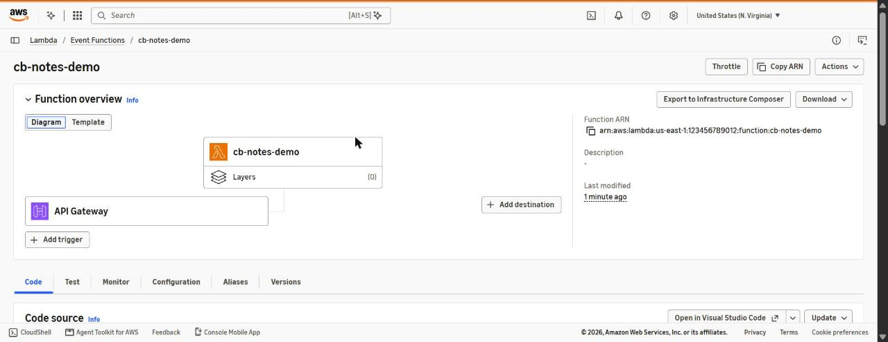
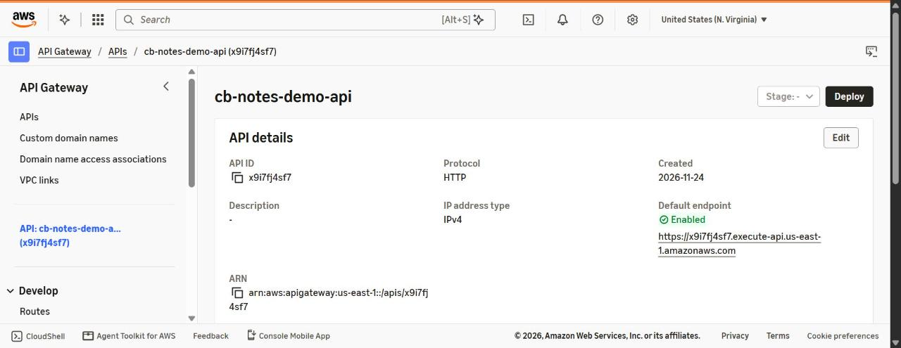
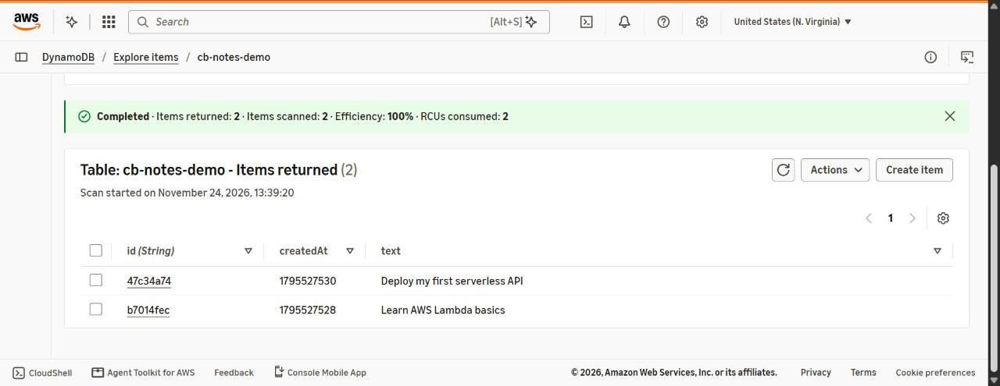
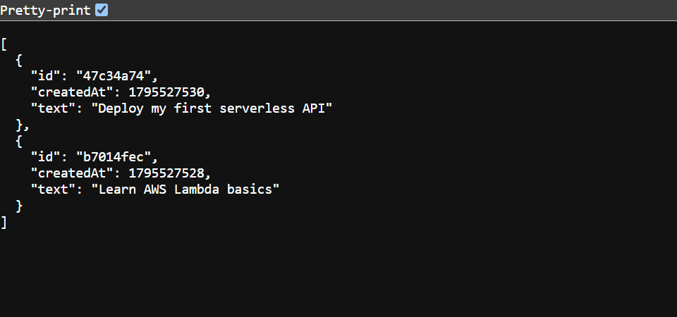

# Serverless Notes API: AWS Lambda + API Gateway + DynamoDB

A minimal, production-style serverless REST API for creating, listing, reading and deleting notes.

```
Client ──HTTPS──▶ API Gateway (HTTP API) ──▶ AWS Lambda (Python 3.12, arm64) ──▶ DynamoDB (on-demand)
```

| Method | Path          | Description    |
|--------|---------------|----------------|
| POST   | `/notes`      | Create a note  |
| GET    | `/notes`      | List notes     |
| GET    | `/notes/{id}` | Get a note     |
| DELETE | `/notes/{id}` | Delete a note  |

## Highlights

- **Least-privilege IAM:** the function can only call 4 DynamoDB actions on its own table.
- **Graviton (arm64)** Lambda for lower cost.
- **HTTP API** with Lambda proxy integration (payload format 2.0).
- **On-demand DynamoDB:** no capacity planning, free-tier friendly.

## Files

| File | Purpose |
|------|---------|
| [`app.py`](app.py) | Lambda handler |
| [`deploy.sh`](deploy.sh) | Creates every resource with the AWS CLI |
| [`cleanup.sh`](cleanup.sh) | Deletes every resource |
| [`screenshots/`](screenshots) | Console screenshots from a real deployment |

## Deploy

```bash
./deploy.sh            # uses us-east-1 by default; override with REGION=eu-west-1 ./deploy.sh
```

## Test

```bash
API=https://<api-id>.execute-api.us-east-1.amazonaws.com
curl -s -X POST $API/notes -H "Content-Type: application/json" -d '{"text":"Hello!"}'
curl -s $API/notes
```

## Screenshots

| Lambda function | HTTP API |
|---|---|
|  |  |

| DynamoDB items | API response |
|---|---|
|  |  |

## Clean up

```bash
./cleanup.sh
```

## Blog post

A full walkthrough of this project is in [BLOG.md](BLOG.md).
