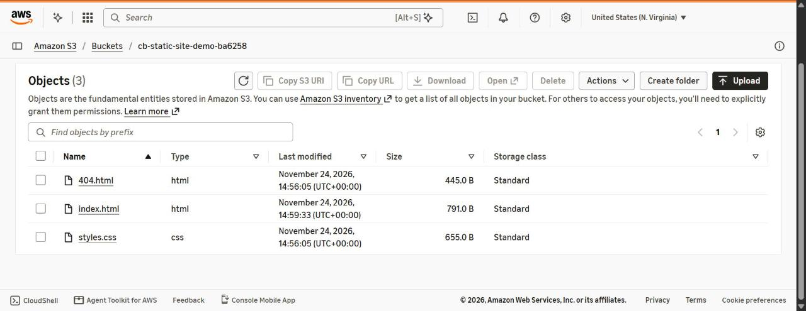
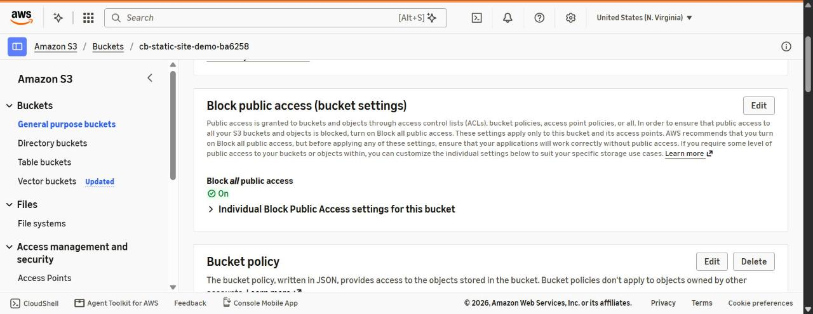
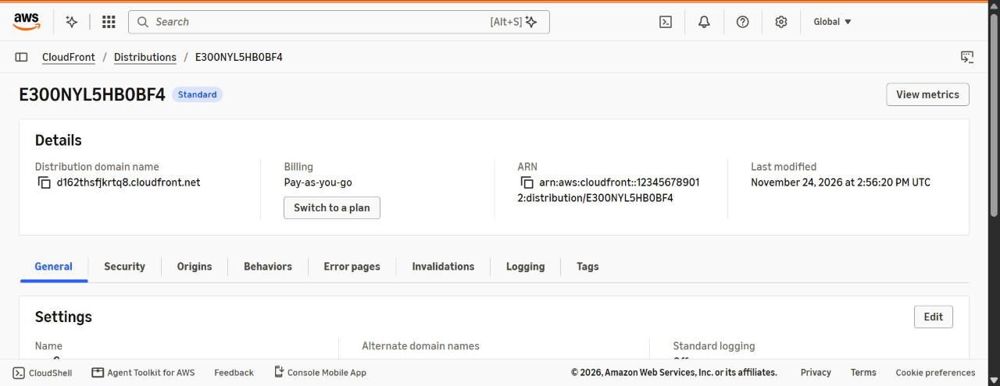
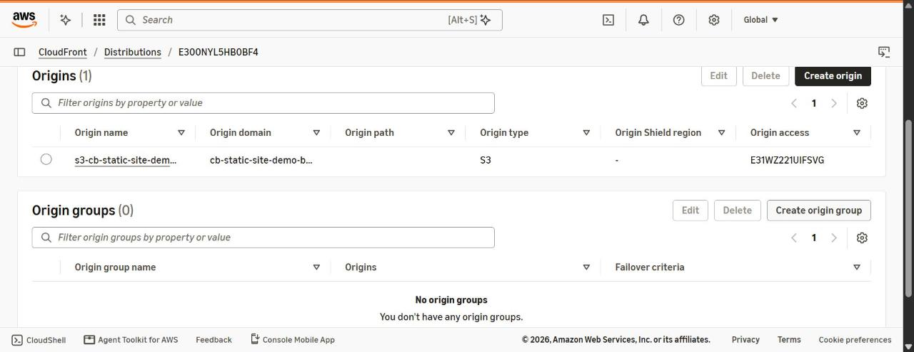
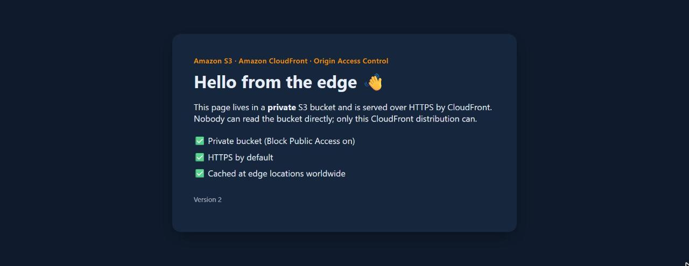
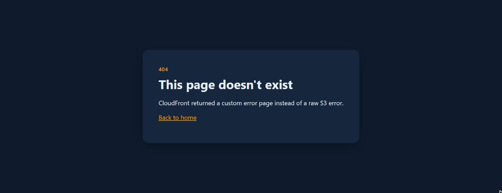
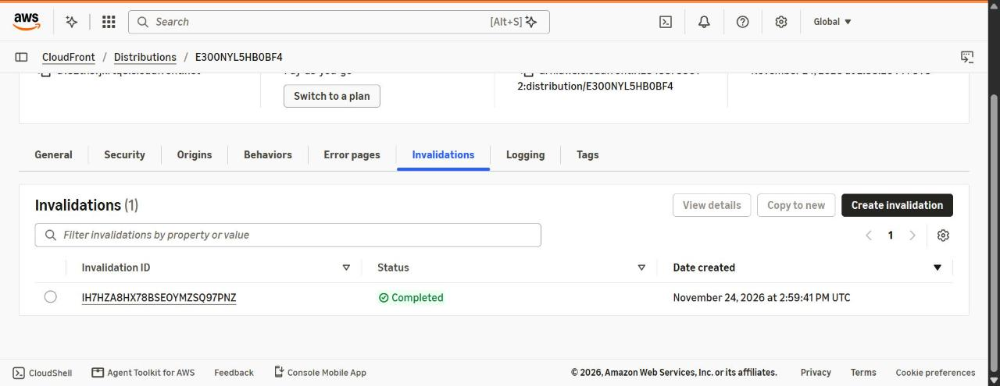

# Host a Secure Static Website on AWS with S3, CloudFront and Origin Access Control


Putting a static website on Amazon S3 takes about two minutes. The common shortcut is to turn on "static website hosting", make the bucket public, and share the S3 website URL. It works, but it leaves you with a public bucket, no HTTPS, and no caching.

In this post I'm doing it the way I'd do it for a real project: the bucket stays **completely private**, **Amazon CloudFront** serves the site over **HTTPS** from edge locations around the world, and **Origin Access Control (OAC)** makes sure CloudFront is the only thing allowed to read the files. I'm also adding a custom 404 page and showing how cache invalidation works when you ship an update.

## What I'm building

```
Browser
   │  HTTPS (HTTP is redirected)
   ▼
Amazon CloudFront  ── custom 404 page, caching, compression
   │  signed requests (Origin Access Control)
   ▼
Amazon S3 bucket  ── private, Block Public Access ON
```

**Prerequisites:** an AWS account, the AWS CLI v2 configured (`aws configure`), and a folder called `site/` containing `index.html`, `404.html` and `styles.css`. I'm using `us-east-1`, but any region works for the bucket.

```bash
export REGION=us-east-1
export NAME=cb-static-site-demo
export BUCKET=$NAME-$(date +%s | tail -c 7)   # bucket names must be globally unique
```

## Step 1: Create a private S3 bucket

New buckets are private by default, but I like to set Block Public Access explicitly so the intent is obvious to anyone reading the script.

```bash
aws s3api create-bucket --bucket $BUCKET --region $REGION

aws s3api put-public-access-block --bucket $BUCKET \
  --public-access-block-configuration \
  BlockPublicAcls=true,IgnorePublicAcls=true,BlockPublicPolicy=true,RestrictPublicBuckets=true
```

> Outside `us-east-1`, add `--create-bucket-configuration LocationConstraint=$REGION` to `create-bucket`.

## Step 2: Upload the site

```bash
aws s3 sync site/ s3://$BUCKET/ --delete
```

`aws s3 sync` sets the right `Content-Type` for `.html` and `.css` files, which matters: without it, browsers download the page instead of rendering it.



At this point the files exist, but nobody can read them. A direct request to the bucket proves it:

```bash
curl -s -o /dev/null -w "%{http_code}\n" https://$BUCKET.s3.$REGION.amazonaws.com/index.html
# 403
```



## Step 3: Create an Origin Access Control

OAC is how CloudFront authenticates to S3. CloudFront signs every request to the bucket with SigV4, and the bucket policy (Step 5) only trusts those signed requests. It replaces the older Origin Access Identity (OAI) and supports features OAI doesn't, such as SSE-KMS encrypted objects.

```bash
OAC_ID=$(aws cloudfront create-origin-access-control \
  --origin-access-control-config \
  "Name=$NAME-oac,SigningProtocol=sigv4,SigningBehavior=always,OriginAccessControlOriginType=s3" \
  --query OriginAccessControl.Id --output text)
```

## Step 4: Create the CloudFront distribution

The distribution config is the heart of this setup. A few choices worth explaining:

- **`DefaultRootObject: index.html`** so visiting `/` serves the home page.
- **`redirect-to-https`** so plain HTTP requests get a 301 to HTTPS.
- **Cache policy `658327ea-…`** is the AWS-managed *CachingOptimized* policy, a sensible default for static files.
- **Custom error responses** map both 403 and 404 from S3 to `/404.html`. A private bucket returns **403** (not 404) for a missing object, so mapping only 404 isn't enough.
- **`PriceClass_100`** uses edge locations in North America, Europe and Israel only, which is the cheapest option. Pick a wider class if your audience is elsewhere.

```bash
cat > dist-config.json <<EOF
{
  "CallerReference": "$NAME-$(date +%s)",
  "Comment": "Static site (S3 + OAC)",
  "Enabled": true,
  "DefaultRootObject": "index.html",
  "PriceClass": "PriceClass_100",
  "HttpVersion": "http2and3",
  "Origins": {"Quantity": 1, "Items": [{
    "Id": "s3-origin",
    "DomainName": "$BUCKET.s3.$REGION.amazonaws.com",
    "OriginAccessControlId": "$OAC_ID",
    "S3OriginConfig": {"OriginAccessIdentity": ""}
  }]},
  "DefaultCacheBehavior": {
    "TargetOriginId": "s3-origin",
    "ViewerProtocolPolicy": "redirect-to-https",
    "CachePolicyId": "658327ea-f89d-4fab-a63d-7e88639e58f6",
    "Compress": true,
    "AllowedMethods": {"Quantity": 2, "Items": ["GET", "HEAD"],
      "CachedMethods": {"Quantity": 2, "Items": ["GET", "HEAD"]}}
  },
  "CustomErrorResponses": {"Quantity": 2, "Items": [
    {"ErrorCode": 403, "ResponsePagePath": "/404.html", "ResponseCode": "404", "ErrorCachingMinTTL": 10},
    {"ErrorCode": 404, "ResponsePagePath": "/404.html", "ResponseCode": "404", "ErrorCachingMinTTL": 10}
  ]}
}
EOF

read -r DIST_ID DIST_DOMAIN DIST_ARN < <(aws cloudfront create-distribution \
  --distribution-config file://dist-config.json \
  --query "Distribution.[Id,DomainName,ARN]" --output text)
```

Notice that the origin uses the bucket's **REST endpoint** (`bucket.s3.region.amazonaws.com`), not the S3 *website* endpoint. OAC only works with the REST endpoint, and it's also why static website hosting stays switched off.





## Step 5: Let only this distribution read the bucket

This bucket policy is what makes the whole design secure. It allows `s3:GetObject` for the CloudFront **service principal**, but only when the request comes from **this specific distribution** (the `AWS:SourceArn` condition). Another CloudFront distribution, even one in another account, gets nothing.

```bash
aws s3api put-bucket-policy --bucket $BUCKET --policy "{
  \"Version\": \"2012-10-17\",
  \"Statement\": [{
    \"Sid\": \"AllowCloudFrontServicePrincipalReadOnly\",
    \"Effect\": \"Allow\",
    \"Principal\": {\"Service\": \"cloudfront.amazonaws.com\"},
    \"Action\": \"s3:GetObject\",
    \"Resource\": \"arn:aws:s3:::$BUCKET/*\",
    \"Condition\": {\"StringEquals\": {\"AWS:SourceArn\": \"$DIST_ARN\"}}
  }]
}"
```

Block Public Access doesn't interfere here, because a policy scoped to a service principal with a `SourceArn` condition isn't considered public.

Deployment to all edge locations takes a few minutes:

```bash
aws cloudfront wait distribution-deployed --id $DIST_ID
echo "https://$DIST_DOMAIN"
```

## Step 6: Test it

```bash
curl -sI https://$DIST_DOMAIN/ | grep -iE "^(HTTP|content-type|x-cache)"
# HTTP/1.1 200 OK
# Content-Type: text/html; charset=utf-8
# X-Cache: Hit from cloudfront

curl -s -o /dev/null -w "%{http_code} -> %{redirect_url}\n" http://$DIST_DOMAIN/
# 301 -> https://<your-distribution>.cloudfront.net/

curl -s -o /dev/null -w "%{http_code}\n" https://$DIST_DOMAIN/nope.html
# 404  (served with the custom error page)

curl -s -o /dev/null -w "%{http_code}\n" https://$BUCKET.s3.$REGION.amazonaws.com/index.html
# 403  (the bucket itself is still private)
```

Every check passes: HTTPS works, HTTP is redirected, missing pages get a friendly 404, and the bucket stays locked down.





## Step 7: Ship an update (and why invalidation matters)

I changed the page from "Version 1" to "Version 2" and uploaded it again:

```bash
aws s3 sync site/ s3://$BUCKET/ --delete
curl -s https://$DIST_DOMAIN/ | grep -o "Version [0-9]"
# Version 1
```

Still Version 1. CloudFront is doing its job: the old copy is cached at the edge, and with the CachingOptimized policy it can stay there for up to a day. To publish immediately, I invalidate the changed path:

```bash
aws cloudfront create-invalidation --distribution-id $DIST_ID --paths "/index.html"
# wait for it to finish, then:
curl -s https://$DIST_DOMAIN/ | grep -o "Version [0-9]"
# Version 2
```



A few practical tips:

- Invalidating `/index.html` also refreshed `/` in my test, because `/` is served through the default root object.
- `"/*"` invalidates everything and still counts as **one path** for billing.
- For CSS and JS, a better long-term pattern is fingerprinted file names (`styles.3f9a1c.css`) so you never need to invalidate them at all.

## What does this cost?

For a small personal or project site: **usually nothing, or a few cents a month.**

- **CloudFront:** the always-free tier includes 1 TB of data transfer out and 10 million requests per month.
- **S3:** a few KB of files costs a fraction of a cent; CloudFront's requests to S3 are minimal thanks to caching.
- **Invalidations:** the first 1,000 paths each month are free.

## Clean up

A distribution has to be disabled before it can be deleted, and disabling takes a few minutes to propagate.

```bash
# 1. Disable the distribution
ETAG=$(aws cloudfront get-distribution-config --id $DIST_ID --query ETag --output text)
aws cloudfront get-distribution-config --id $DIST_ID --query DistributionConfig --output json \
  | sed 's/"Enabled": true/"Enabled": false/' > disabled.json
aws cloudfront update-distribution --id $DIST_ID --if-match $ETAG \
  --distribution-config file://disabled.json
aws cloudfront wait distribution-deployed --id $DIST_ID

# 2. Delete the distribution and the OAC
ETAG=$(aws cloudfront get-distribution --id $DIST_ID --query ETag --output text)
aws cloudfront delete-distribution --id $DIST_ID --if-match $ETAG
OAC_ETAG=$(aws cloudfront get-origin-access-control --id $OAC_ID --query ETag --output text)
aws cloudfront delete-origin-access-control --id $OAC_ID --if-match $OAC_ETAG

# 3. Empty and delete the bucket
aws s3 rm s3://$BUCKET --recursive
aws s3api delete-bucket --bucket $BUCKET
```

## Where to go next

- Add a **custom domain** with an ACM certificate (it must be issued in `us-east-1` for CloudFront) and a Route 53 alias record.
- Add **security headers** (HSTS, CSP, X-Frame-Options) with a CloudFront response headers policy.
- Attach **AWS WAF** for rate limiting and managed rule groups.
- Automate deploys with **GitHub Actions**: `aws s3 sync` followed by a targeted invalidation on every push.
