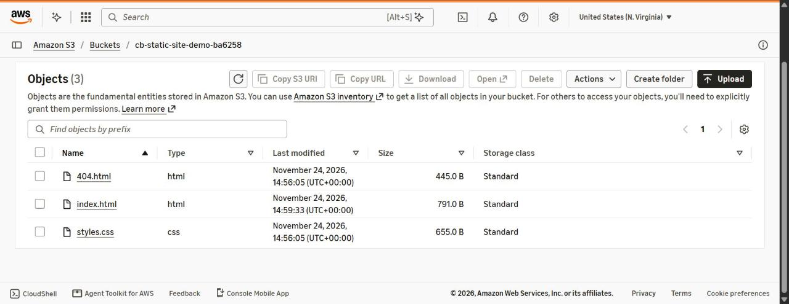
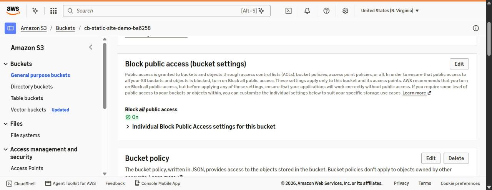
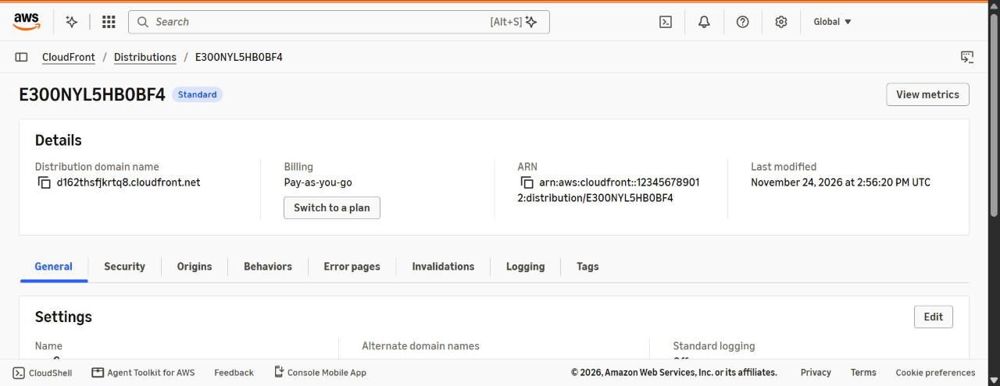
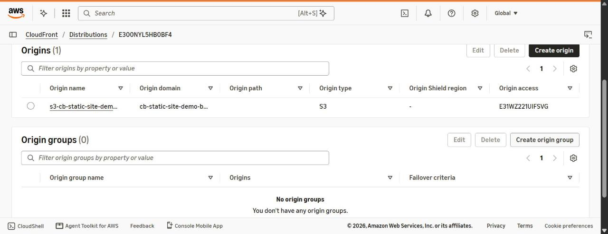
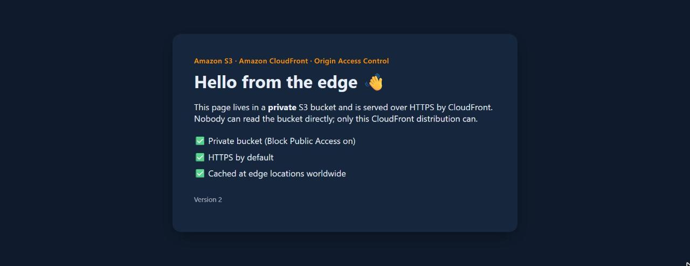
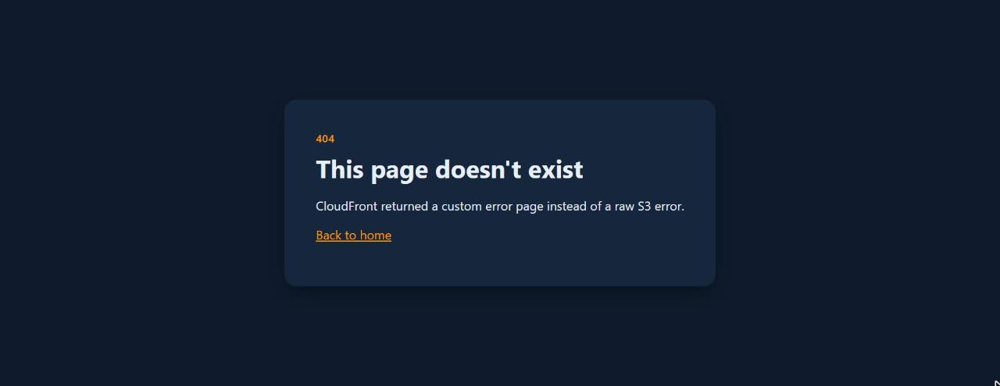

# Secure Static Website: Amazon S3 + CloudFront + Origin Access Control

A static site served over HTTPS by Amazon CloudFront from a **private** S3 bucket. Only the CloudFront distribution can read the bucket, enforced with Origin Access Control (OAC) and a `SourceArn`-scoped bucket policy.

```
Browser ──HTTPS──▶ CloudFront (cache, compression, custom 404) ──OAC (SigV4)──▶ S3 (private)
```

## Highlights

- **Private bucket:** Block Public Access on; direct S3 requests return `403`.
- **Origin Access Control:** CloudFront signs requests to S3; the bucket policy trusts only this distribution.
- **HTTPS by default:** HTTP is redirected with a `301`.
- **Custom 404 page:** S3 `403`/`404` responses are mapped to `/404.html`.
- **Cache invalidation** demo for shipping updates.

## Files

| File | Purpose |
|------|---------|
| [`site/`](site) | The static site (`index.html`, `404.html`, `styles.css`) |
| [`deploy.sh`](deploy.sh) | Creates the bucket, OAC, distribution and bucket policy |
| [`cleanup.sh`](cleanup.sh) | Disables and deletes everything |
| [`screenshots/`](screenshots) | Console screenshots from a real deployment |

## Deploy

```bash
./deploy.sh            # REGION=eu-west-1 ./deploy.sh to use another region
```

## Ship an update

```bash
source .deploy.env
aws s3 sync site/ s3://$BUCKET/ --delete
aws cloudfront create-invalidation --distribution-id $DIST_ID --paths "/index.html"
```

## Screenshots

| Private bucket | Block Public Access |
|---|---|
|  |  |

| Distribution | Origin with OAC |
|---|---|
|  |  |

| Live site | Custom 404 |
|---|---|
|  |  |

## Clean up

```bash
./cleanup.sh
```

## Blog post

A full walkthrough is in [BLOG.md](BLOG.md).
